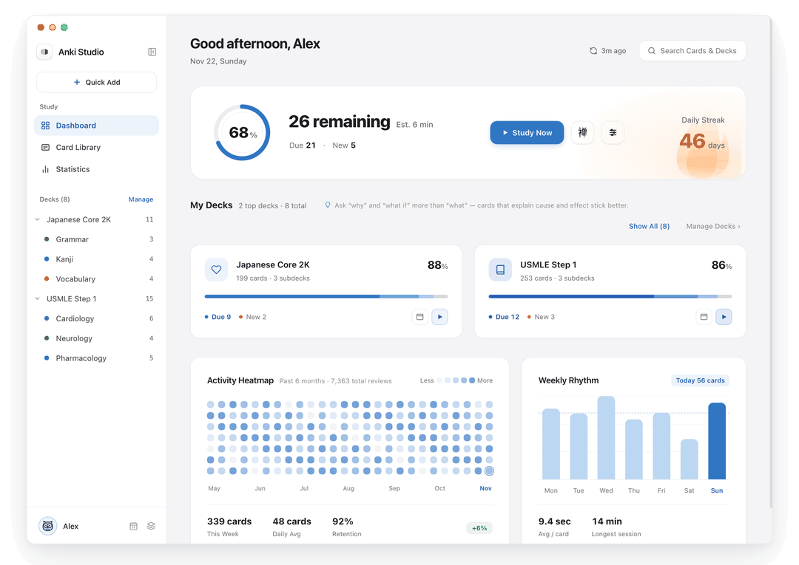
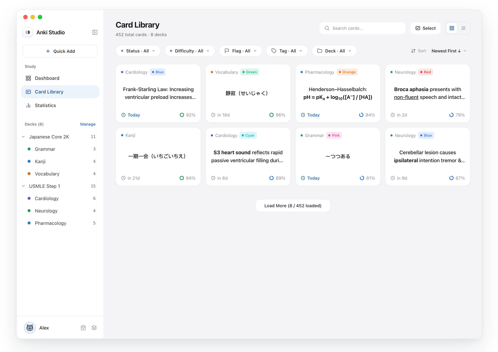

# Anki Studio

**[English](#english) · [简体中文](#简体中文)** · **[AnkiWeb Add-on (`1071937836`)](https://ankiweb.net/shared/info/1071937836)**

---

> A calm, Apple HIG–inspired desktop workspace for Anki — built for focused daily study with FSRS analytics, Vacation Mode, Schedule Relief, and **zero mini-games**. Completely compatible with official AnkiWeb sync and 16 interface languages.

## Quick Install

1. Open Anki (**26.09.4 or later** on macOS, Windows, or Linux).
2. Go to **Tools → Add-ons → Get Add-ons...**
3. Enter add-on code: **`1071937836`**
4. Restart Anki.

> **Instant Escape Hatch:** Press `Ctrl+Opt+M` (macOS) / `Ctrl+Alt+M` (Windows & Linux), or click the toolbar/Tools menu toggle anytime to switch back to classic Anki in one second.

---

## Highlights

- **Distraction-Free Workspace** — Today Dashboard with daily goal ring, streak tracker, 26×7 learning heatmap, deck mastery bars derived harmoniously from your accent color, and weekly review rhythm.
- **Calm Reviewer** — spacious centered card stage with FSRS interval previews (`Again / Hard / Good / Easy`), Cloze, MathJax/KaTeX, flags, tags, `Aa` stage width & scale controls, **75%–500% pan-and-zoom image/mind-map lightbox**, and independent front/back audio auto-play switches.
- **System Auto, Light & Dark + 8 Accent Atmospheres** — auto-follows your OS appearance across 8 accent palettes; keep **Indigo** for 100% pure neutral minimalism, or pick 7 optional warm-paper & illustration themes (*Botanical Journal, Washi & Matcha, Cozy Café, Study Cat, Observatory, Pastel Sky, Bookplate Study*).
- **FSRS Analytics & Memory Insights** — 30-day due workload forecast, card maturity lifecycle breakdown, 12-week historical retention trend, 24-hour focus breakdown, and strict FSRS True Retention.
- **Burnout Shield (`Vacation Mode` & `Schedule Relief`)** — freeze new-card limits, snapshot & shift due dates without breaking intervals or streaks, spread overdue backlogs smoothly over *N* days, or trigger a curated 10–15 card **Light Session** on exhausted days.
- **Fast Card Library** — filter by status, difficulty, flag, tag, or deck; multi-select to batch edit, suspend, bury, move, or delete.
- **Safe Script & Image Occlusion Compatibility** — write Cloze notes, tables, and math natively; template-driven and native Image Occlusion cards render faithfully in isolated **Compatibility Mode** without flattening or altering your original notes.
- **16 Interface Languages** — auto-matches your Anki locale across English, 简体中文, 繁體中文, 日本語, 한국어, Deutsch, Français, Español, Italiano, Português (Brasil), Русский, Nederlands, Polski, Türkçe, Tiếng Việt, and العربية.

---

## Screenshots

| Today Dashboard (Light) | Calm Cloze Reviewer |
|---|---|
|  |  |

| Card Library (Grid + KaTeX) | FSRS Analytics (Dark Mode) |
|---|---|
|  |  |

| Schedule Relief | Vacation Mode |
|---|---|
|  |  |

---

## Safety, Compatibility & Privacy

- **Anki Requirement**: **Anki 26.09.4 or later** (`min_point_version: 260904`, Qt6 / Python 3.13) on macOS, Windows, and Linux.
- **100% Native Anki Writes**: All writes go exclusively through Anki's official Python API (`col.update_card`, `col.sched.*`), letting Anki maintain `mod` / `usn` directly so **AnkiWeb sync remains untouched**.
- **Privacy First**: Card contents, deck names, tags, and search queries **never leave your device**. Optional anonymous usage counters (launches, daily activity, session-size buckets, feature usage) can be disabled anytime in **Settings → About**, or pointed to a self-hosted endpoint (`scripts/analytics-worker/`).

---

## 简体中文

> 专为 Anki 打造的现代化、桌面级沉浸式记忆工作区。以 Apple 人机交互设计规范（HIG）为审美基准，界面支持 16 种语言，并沿用 Anki 原生同步链路（不介入其数据流），与 AnkiWeb 双向同步兼容。

### 🌟 核心特性

- **macOS 沉浸式标题栏**：无缝延伸至原生红黄绿交通灯后方，支持无感拖拽与系统级窗口缩放。
- **0 毫秒首帧启动**：Qt 底层背景颜色预注入 + HTML 预挂载骨架，彻底消除传统 Web 插件冷启动白屏。
- **全局瀑布流级联同步**：顶部状态指示、环形进度雷达、牌组卡片、26×7 学习热力图与周节奏图表全屏协同呼吸。
- **4 级统一按钮系统**：严谨的视觉层级（Primary、Secondary、Ghost、Icon Circle），提供细腻的物理触感反馈。
- **🌴 休假守护与雪崩急救**：内建事前休假（新卡冻结 + 顺延 + 连胜冰冻 Streak Freeze）、事后削峰填谷（卡片均匀平摊消化）与低能量极简打卡模式。
- **学习专注细节升级**：复习页支持 `Aa` 舞台宽度与字号调节、图片/思维导图 **75%–500% 无极缩放灯箱**，以及正面/背面独立的卡片音频自动播放双开关。
- **三层防迷失安全网**：快捷键 `Ctrl+Opt+M` / `Ctrl+Alt+M`、工具菜单入口与原生工具栏常驻彩色胶囊，随时秒切原生。
- **多主题与纸感氛围**：支持 `跟随系统 (System)`、`浅色 (Light)`、`深色 (Dark)` 三种显示模式与 8 套品牌强调色；默认经典蓝（`Indigo`）严格保持零插画纯白极简工作台，其余 7 款强调色各自绑定专属纸感与微插画氛围（植物手账、京都和纸、窗边咖啡馆、橘猫伴读、星夜天文台、云端纸飞机、古典藏书阁），首页牌组卡配色由所选强调色和谐派生。
- **16 种界面语言**：简繁中文、英、日、韩、德、法、西、意、葡（巴西）、俄、荷、波、土、越、阿，可跟随 Anki 客户端语言自动切换。

---

### ✅ 兼容性

| 项 | 说明 |
|---|---|
| Anki 版本 | **26.09.4 及以上**（`min_point_version: 260904`） |
| 运行环境 | Qt6 / Anki 内置 Python 3.13 |
| 操作系统 | macOS、Windows、Linux（三端均已适配平台快捷键与路径） |
| 数据安全 | 全部写操作走 Anki 官方 API（`col.update_card` / `col.sched.*`），由 Anki 维护 `mod` / `usn`，不直接改写合集数据库文件 |
| 运行时自检 | 启动时校验 Anki 版本、4 个原生界面补丁与 8 个生命周期钩子；任一失效会在控制台打印 `patch health` 报告，也可通过 `get_patch_health` 读取 |
| 网络 | 同步仍由 Anki 原生完成；可选的匿名使用统计只上报计数（不含卡片内容），可在设置中关闭 |

> 为什么下限写死在一个具体版本：Anki 的兼容判断是 `int_version() < min_point_version`，而 `int_version()` 是 `YYMMDD` 整数（26.9.4 → `260904`）。写一个小数字（例如 `26`）等于宣称兼容所有版本，会让旧版用户装上一个必然崩溃的插件。下限可以下探，但必须在对应 Anki 版本上实测通过后再改。

### 📄 许可

本项目以 [MIT License](LICENSE) 发布。

### 隐私与匿名统计

- 卡片内容、牌组名、标签、搜索词、学习记录**永远不会上传**；所有学习数据只存在你自己的 Anki 里。
- 可选匿名统计（默认开启，设置 → 关于可关闭）：只上报启动、日活、复习会话张数区间、功能使用计数，以及版本 / 系统 / Anki 版本 / 界面语言 / 国家地区代码 / 时区偏移 / 随机安装 ID 的哈希。
- 统计端点可自建（见 `scripts/analytics-worker/`）；`analytics_endpoint` 为空时插件完全不发请求。
