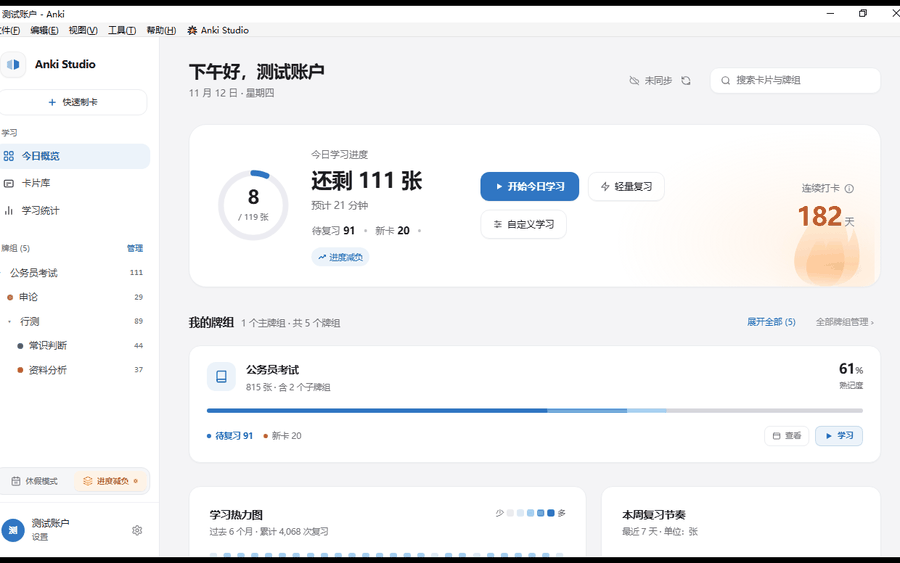

# Anki Studio

> 专为 Anki 打造的现代化、桌面级沉浸式记忆工作区。以 Apple 人机交互设计规范（HIG）为审美基准，界面支持 16 种语言，并沿用 Anki 原生同步链路（不介入其数据流），与 AnkiWeb 双向同步兼容。



---

## 🌟 核心特性

- **macOS 沉浸式标题栏**：无缝延伸至原生红黄绿交通灯后方，支持无感拖拽与系统级窗口缩放。
- **0 毫秒首帧启动**：Qt 底层背景颜色预注入 + HTML 预挂载骨架，彻底消除传统 Web 插件冷启动白屏。
- **全局瀑布流级联同步**：顶部状态指示、环形进度雷达、牌组卡片、26×7 学习热力图与周节奏图表全屏协同呼吸。
- **4 级统一按钮系统**：严谨的视觉层级（Primary、Secondary、Ghost、Icon Circle），提供细腻的物理触感反馈。
- **🌴 休假守护与雪崩急救**：内建事前休假（新卡冻结 + 顺延 + 连胜冰冻 Streak Freeze）、事后削峰填谷（卡片均匀平摊消化）与低能量极简打卡模式。
- **三层防迷失安全网**：快捷键 `Ctrl+Opt+M` / `Ctrl+Alt+M`、工具菜单入口与原生工具栏常驻彩色胶囊，随时秒切原生。
- **多主题与个性化**：支持 Light、Dark、OLED 纯黑三种专业主题，以及 8 套品牌强调色；首页牌组卡配色由所选强调色派生，同色系内做深浅分级，不会出现一套彩虹色。
- **16 种界面语言**：简繁中文、英、日、韩、德、法、西、意、葡（巴西）、俄、荷、波、土、越、阿，可跟随 Anki 客户端语言自动切换。

---

## 📖 设计与开发规范手册

为保持后续迭代的代码与视觉一致性，请务必参阅项目内部规范标准：

👉 **[详细设计规范与开发工程标准手册 (docs/DESIGN_AND_DEV_GUIDELINES.md)](docs/DESIGN_AND_DEV_GUIDELINES.md)**  
👉 **[项目改动日志与多助手协同协议 (CHANGELOG.md)](CHANGELOG.md)**

该文档涵盖：
1. **色彩与主题矩阵**：Light、Dark、OLED 调色板与语义 Token。
2. **按钮四级体系**：`btn-primary`、`btn-secondary`、`btn-ghost`、`btn-icon-circle` 的类名规范与交互微动效。
3. **动效流水线**：阶段一同步呼吸（1.8s）到阶段二瀑布流入场（0.8s）的编排细节。
4. **前端工程规范**：`useSyncExternalStore` 状态单向流、防中断保护锁、Modern Web 合成器动效铁律。
5. **IPC 桥接与构建红线**：双向安全通信规范、自动化测试与构建发布流水线。

---

## 🛠️ 本地开发与构建

### 1. 前端开发
```bash
cd frontend
npm install
npm run dev      # 启动本地开发热更新服务器 (localhost:5173)
npm run build    # 打包生产静态资源到 web/ 目录
```

### 2. 自动化测试与体检
```bash
node tests/test_frontend_bundle.mjs                   # 前端字符串审计：护栏 / IPC / 样式 / i18n
node tests/frontend/run.mjs                           # 前端单元套件：纯逻辑 + 叶子组件渲染（63 项）
python3 -m unittest discover -s tests -p "test_*.py"  # Python 侧单元测试（115 项，含兼容性自检、通用修复与 CSS 解析回归）

cd tests/scenarios && ./gate.sh                       # 隔离场景冒烟：11 个场景 / 692 项检查（不动真实数据）
python3 tests/apkg/run.py                             # 真实 .apkg 显示兼容性：17 个排名卡组（需本地卡组，约 16 秒）
```

前三组都必须全绿再提交；改完还要跑一次 `npm run build`，确保 `web/assets` 与源码同步。
改到桥接层业务逻辑时，再跑一次场景冒烟。前端单元套件只依赖 `frontend/node_modules`
里已有的 esbuild，无需额外安装测试框架。

### 3. 打包发布
```bash
python3 scripts/build_ankiaddon.py
```
打包完成后会在根目录生成 `anki_modern_os.ankiaddon` 安装包，并打印其 SHA-256；随后自动复制一份到 `~/Downloads/anki_modern_os.ankiaddon`（覆盖旧包），方便直接上传 AnkiWeb 或装到另一台机器。加 `--no-downloads` 可关闭复制。

脚本只按白名单收运行时文件（`__init__.py`、`manifest.json`、`config.json`、`config.md`、
`bridge/`、`web/`），并保证：顶层不带包裹目录、不含 `__pycache__`、不打包 `meta.json`、
随包的 `config.json` 会剥掉昵称与学习记录等私人数据。打包时还会自动把 `manifest.json`
的 `mod` 刷新为当前时间戳（AnkiWeb 靠它判断版本更新），并校验 `min_point_version`
与 `human_version` 是否合法。

### 4. 预览图
README 与 AnkiWeb 简介页共用同一张循环 GIF，由 `scripts/build_preview_gif.py` 生成。
把若干张同尺寸、同构图的整窗截图传进去即可重建，宽度、每帧停留时长、是否淡入都可调：

```bash
python3 scripts/build_preview_gif.py \
  --frames 01-dashboard.jpg 02-search.jpg 03-relief.jpg 04-vacation.jpg \
  --out docs/assets/anki-studio-preview.gif --width 1200 --hold-ms 2800
```

GIF 只有 256 色，画质上有几个已经踩过并写在脚本 docstring 里的坑（JPEG 白噪声污染调色板、
全局调色板反而放大会差、抖动与预模糊是负收益），改参数前建议先读一遍。

---

## ✅ 兼容性

| 项 | 说明 |
|---|---|
| Anki 版本 | **26.09.4 及以上**（`min_point_version: 260904`） |
| 运行环境 | Qt6 / Anki 内置 Python 3.13 |
| 操作系统 | macOS、Windows、Linux（三端均已适配平台快捷键与路径） |
| 数据安全 | 全部写操作走 Anki 官方 API（`col.update_card` / `col.sched.*`），由 Anki 维护 `mod` / `usn`，不直接改写合集数据库文件 |
| 运行时自检 | 启动时校验 Anki 版本、4 个原生界面补丁与 8 个生命周期钩子；任一失效会在控制台打印 `patch health` 报告，也可通过 `get_patch_health` 读取 |
| 网络 | 插件本身**不发任何网络请求**，同步仍由 Anki 原生完成 |

> 为什么下限写死在一个具体版本：Anki 的兼容判断是 `int_version() < min_point_version`，
> 而 `int_version()` 是 `YYMMDD` 整数（26.9.4 → `260904`）。写一个小数字（例如 `26`）
> 等于宣称兼容所有版本，会让旧版用户装上一个必然崩溃的插件。下限可以下探，
> 但必须在对应 Anki 版本上实测通过后再改。

## 📄 许可

本项目以 [MIT License](LICENSE) 发布。

