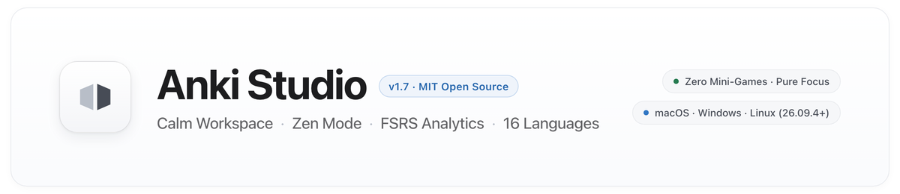
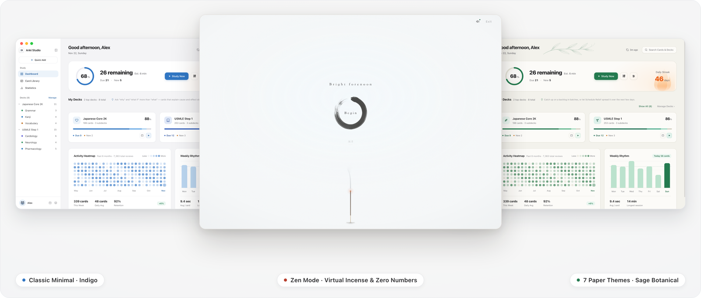
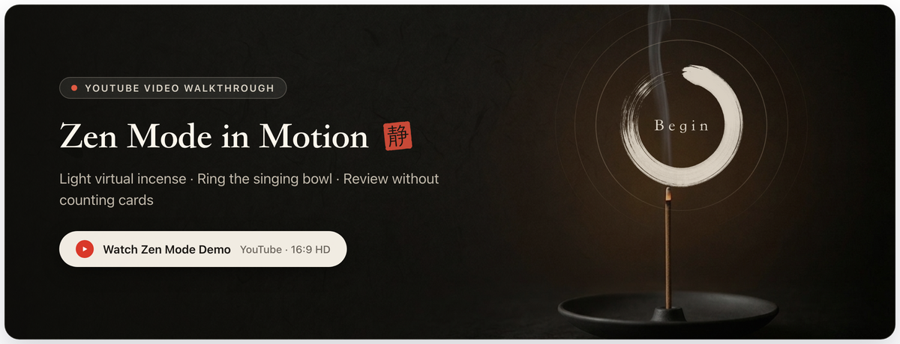
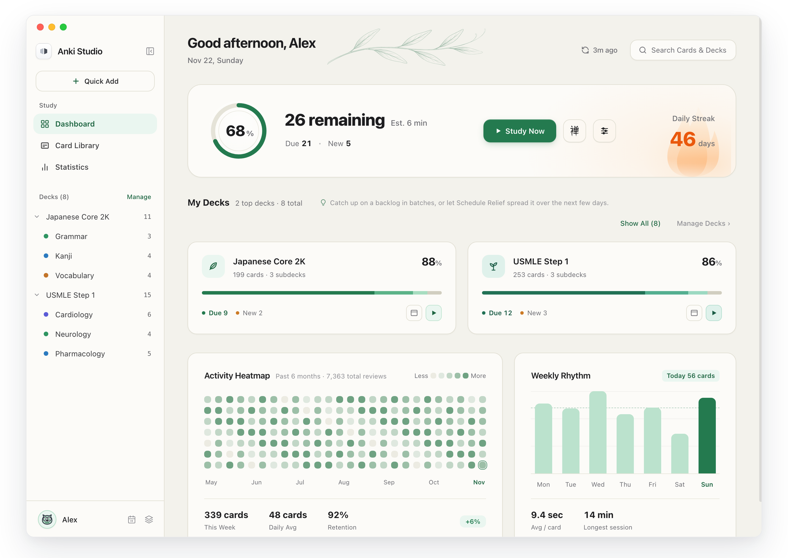
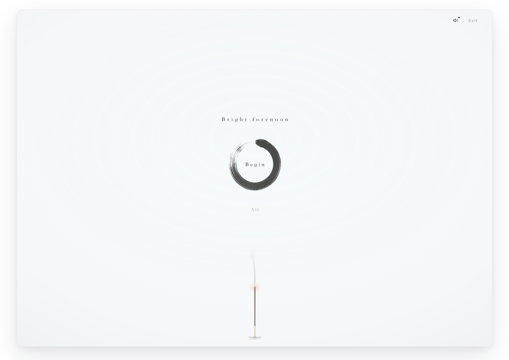
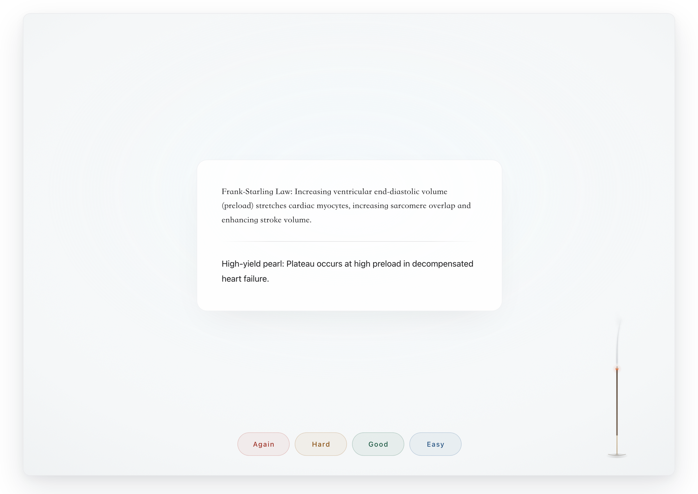
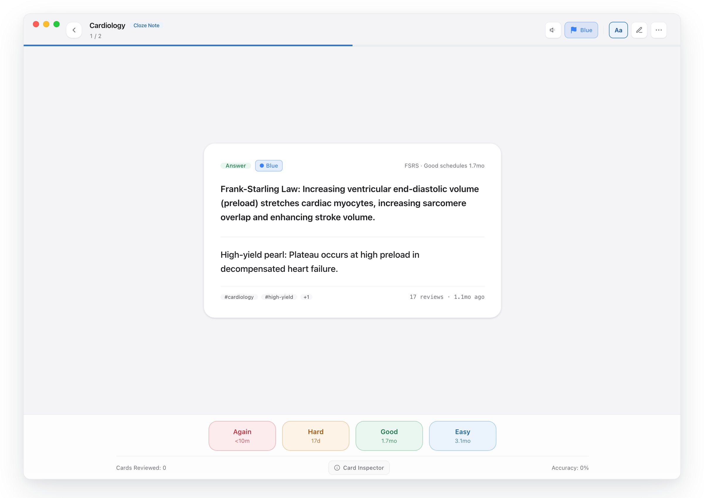
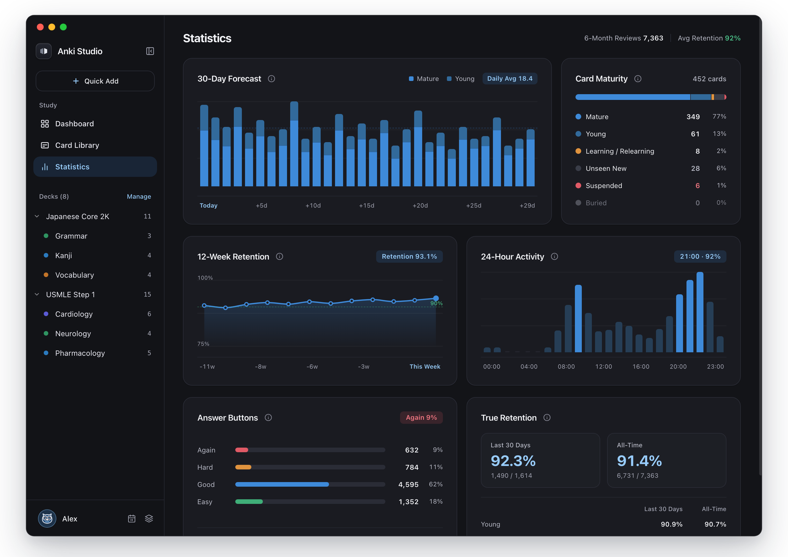
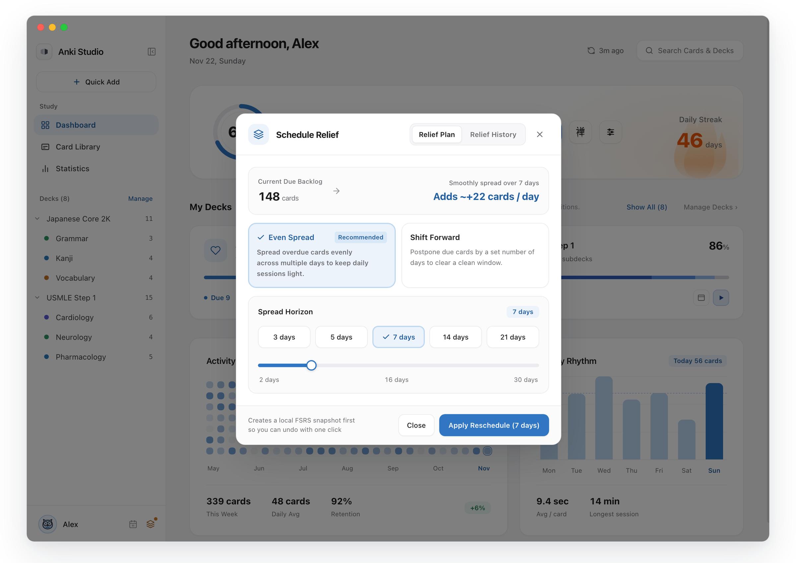
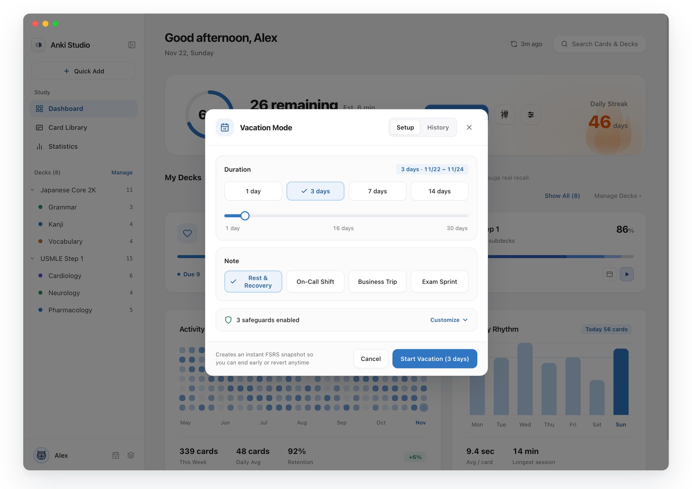

# Anki Studio

**[English](#english) · [简体中文](#简体中文) · [AnkiWeb Add-on (`1071937836`)](https://ankiweb.net/shared/info/1071937836) · [Zen Mode Video Demo](https://youtu.be/g6Fx8M_FuNA)**

---

> A calm, Apple HIG–inspired desktop workspace for Anki — featuring **Zen Mode**, **macOS trackpad swipe review**, **FSRS analytics**, **Vacation Mode**, and **Schedule Relief**, with **zero mini-games**. Completely compatible with official AnkiWeb sync and 16 interface languages.

## Quick Install

1. Open Anki (**26.09.4 or later** on macOS, Windows, or Linux).
2. Go to **Tools → Add-ons → Get Add-ons...**
3. Enter add-on code: **`1071937836`**
4. Restart Anki.

> **Instant Escape Hatch:** Press `Ctrl+Opt+M` (macOS) / `Ctrl+Alt+M` (Windows & Linux), or click the toolbar/Tools menu toggle anytime to switch back to classic Anki in one second.

---

## Highlights (v1.7)

- **Zen Mode (`Cmd/Ctrl+Shift+Z`)** — Step into a zero-number Washi study sanctuary. Light virtual sandalwood incense, hear a synthesized singing-bowl chime, and review calmly beside a 15-minute burning desk incense timer and pure offline ambient soundscapes (*Eaves rain, Pine wind, Warm stillness*).
- **macOS Trackpad Swipe Review (`v1.7.1`)** — 120fps GPU-driven Tinder-style card swiping (`Left = Again`, `Right = Good`), two-finger pull-to-flip, and native Cocoa haptic feedback — engineered with zero-rerender compositing and smart safeguards against accidental triggers.
- **Calm Workspace & Today Dashboard** — Collapsible spring-animated sidebar (`Cmd/Ctrl+\`), animated daily goal ring, streak tracker, soft-tile `26×7` activity heatmap, weekly rhythm with average baseline, custom circular avatar cropping/rotation, and harmonious deck mastery bars.
- **Focused Reviewer** — Centered card stage with FSRS interval previews (`Again / Hard / Good / Easy`), Cloze, MathJax/KaTeX, flags, tags, `Aa` stage width & scale controls, **75%–500% pan-and-zoom image lightbox**, independent front/back audio auto-play switches, and a `2×3` card drawer with **Reset Progress** and unified undo (`Cmd/Ctrl+Z`).
- **Auto, Light & Dark + 8 Themes** — Auto-follows your OS appearance across 8 accent palettes: keep **Indigo** for 100% pure neutral minimalism, or pick 7 optional warm-paper themes with hand-crafted watercolor-mask illustrations (*Botanical, Kyoto Washi, Café, Study Cat, Observatory, Cloudscape, Classic Library*).
- **Redesigned FSRS Analytics** — 30-day workload forecast, 6-stage maturity lifecycle breakdown, 12-week retention curve with a 90% target baseline, 24-hour peak focus window, and strict FSRS True Retention.
- **Burnout Protection (`Vacation Mode` & `Schedule Relief`)** — Freeze new-card limits and shift due dates without breaking intervals or streaks, spread overdue backlogs smoothly over *N* days, or trigger a curated 10–15 card **Light Session** on low-energy days.
- **Instant Large-Collection Performance & Script Sandbox** — Read-only SQL fast paths keep filtering, sorting, and previews snappy on 10,000+ card collections. Global **Compatibility Mode** and automatic sandbox detection handle `Enhanced Cloze`, `Cloze Overlapping`, custom JS/CSS templates, and Image Occlusion seamlessly without touching your notes.
- **16 Interface Languages** — Auto-matches your Anki locale across English, 简体中文, 繁體中文, 日本語, 한국어, Deutsch, Français, Español, Italiano, Português (Brasil), Русский, Nederlands, Polski, Türkçe, Tiếng Việt, and العربية (including RTL).

---

## Screenshots

| Today Dashboard (Classic Minimal · Indigo) | Sage Botanical Theme (Warm Paper + Watercolor) |
|---|---|
|  |  |

| Zen Mode Courtyard (Incense Ritual & Ensō) | Zen Mode Review (Washi Paper + 15-Min Incense Timer) |
|---|---|
|  |  |

| Calm Cloze Reviewer | Card Library (Faceted Grid) |
|---|---|
|  |  |

| FSRS Analytics (Dark Mode) | Schedule Relief | Vacation Mode |
|---|---|---|
|  |  |  |

---

## Safety, Compatibility & Privacy

- **Anki Requirement**: **Anki 26.09.4 or later** (`min_point_version: 260904`, Qt6 / Python 3.13) on macOS, Windows, and Linux.
- **100% Native Anki Writes**: All writes go exclusively through Anki's official Python API (`col.update_card`, `col.sched.*`), letting Anki maintain `mod` / `usn` directly so **AnkiWeb sync remains untouched**.
- **Per-Profile Isolation**: Custom avatars, nicknames, and workspace preferences are stored per Anki Profile cleanly.
- **Privacy First**: Card contents, deck names, tags, and search queries **never leave your device**. Optional anonymous usage counters (launches, daily active days, session-size buckets, feature counts) can be disabled anytime in **Settings → About**, or pointed to a self-hosted endpoint (`scripts/analytics-worker/`).
- **AI Disclosure**: Most of the code was written with AI under my direction, and verified jointly by me and AI through automated unit/smoke tests plus manual testing on real decks across macOS and Windows.

---

## 简体中文

> 专为 Anki 打造的现代化、桌面级沉浸式学习工作区。以 Apple 人机交互设计规范（HIG）为审美基准，集成了**极简禅模式**、**macOS 触控板 120fps 跟手划卡**、**FSRS 深度记忆统计**与**防倦怠休假/积压减负**；支持 16 种语言，所有写操作均走 Anki 原生官方 API，与 AnkiWeb 双向同步完全兼容。

### 🌟 核心特性（v1.7）

- **🕯️ 极简禅模式（`Cmd/Ctrl+Shift+Z`）**：步入无数字焦虑的纯纸背诵空间。亲手点亮案头檀香，伴随青铜颂钵混响与水墨圆相「开卷」；背诵时隐藏一切统计数字与 FSRS 间隔，书案一角静置 15 分钟流体燃香计时，支持纯离线 Web Audio 声景（檐雨 / 松风 / 暖寂）。
- **👆 macOS 触控板跟手划卡与触觉反馈（`v1.7.1`）**：背面固定 `左滑重来 · 右滑良好`、顶部双指下拉翻面，基于原生滚轮相位事件实现 120fps 零重渲染跟手物理动效与 Cocoa Taptic 轻震反馈，并内置捏合/横滚/鼠标防误触保护。
- **🗂️ 桌面级工作台与动态首页**：左侧边栏支持点击与 `Cmd/Ctrl+\` 弹簧缩放；首页集成动态目标圆环、连续打卡、柔角 26×7 热力图、周均虚线复习节奏、个人圆形头像交互裁切与旋转，以及由强调色和谐派生的牌组掌握度条。
- **📖 沉浸复习与 `2×3` 操作抽屉**：支持 `Aa` 舞台宽度与字号调节、**75%–500% 图片/思维导图缩放灯箱**、正面/背面独立自动播音双开关、`2×3` 六宫格卡片操作抽屉（含**重置进度**与全局 `Cmd/Ctrl+Z` 统一撤销）。
- **🎨 三态显示 × 8 套主题与淡墨插画**：支持 `跟随系统 / 浅色 / 深色` 三种显示模式；默认经典蓝（`Indigo`）严格保持零插画纯白极简，其余 7 款强调色各自搭配温润纸感底色与手绘水彩蒙版微插画（植物手账、京都和纸、窗边咖啡馆、橘猫伴读、星夜天文台、云端纸飞机、古典藏书阁）。
- **📊 重制版 FSRS 深度统计**：未来 30 天复习负荷预测、6 阶段卡片生命周期分布、带 90% 目标线的近 12 周保持率平滑面积图、24 小时黄金时段分析，以及严格口径 FSRS True Retention。
- **🌴 休假守护与雪崩急救**：事前休假支持冻结新卡、顺延到期日并冰冻连胜；事后积压减负支持将逾期卡片均匀平摊至 *N* 天（内置快照一键撤销）；低能量日可选 10–15 张轻量队列。
- **⚡ 大卡库 SQL 快路径与通用兼容沙盒**：万张以上卡库的卡片库筛选/排序、自定义学习预览与批量动作全部重构为只读 SQL 快路径；全局兼容模式 + `Enhanced Cloze` / `Cloze Overlapping` / 图像遮挡通用沙盒开箱即用，不篡改原笔记。
- **🛡️ 三重返回原生安全网 & 16 语种**：快捷键 `Ctrl+Opt+M` / `Ctrl+Alt+M`、工具菜单与顶栏入口一秒切回原版 Anki；支持含 RTL（阿拉伯语）在内的 16 种界面语言。

---

### ✅ 兼容性

| 项 | 说明 |
|---|---|
| Anki 版本 | **26.09.4 及以上**（`min_point_version: 260904`） |
| 运行环境 | Qt6 / Anki 内置 Python 3.13 |
| 操作系统 | macOS、Windows、Linux（三端均已适配平台快捷键与路径） |
| 数据安全 | 全部写操作走 Anki 官方 API（`col.update_card` / `col.sched.*`），由 Anki 维护 `mod` / `usn`，不直接改写合集数据库文件 |
| 档案隔离 | 个性化头像、昵称与偏好按 Anki Profile 隔离保存，绝不混入发布包 |
| 网络与隐私 | 卡片内容、牌组名、标签与搜索词**永远不会离开你的设备**；可选匿名使用计数可在「设置 → 关于」关闭或自建统计服务端（`scripts/analytics-worker/`） |

### 📄 许可与源码

本项目以 [MIT License](LICENSE) 发布，欢迎前往 [GitHub Issues](https://github.com/gripet43/anki-studio/issues) 提交建议与问题反馈。
