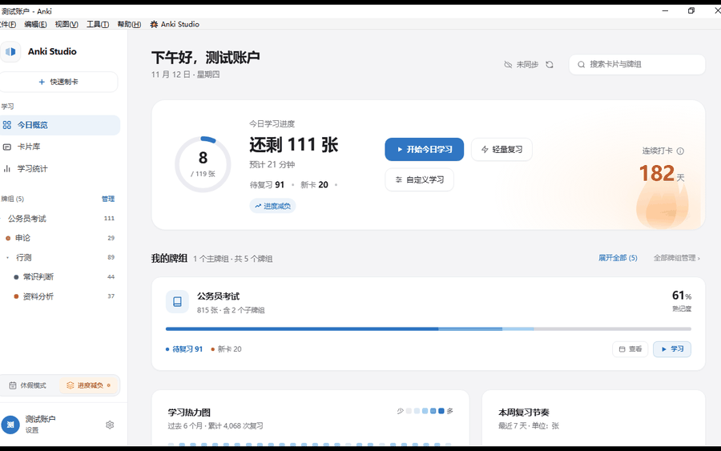

# AnkiWeb 上架资料（v1.4.9）

> 上传入口：<https://ankiweb.net/shared/addons> → Upload
> 表单只有五个字段：Title、Tags、Support Page、Branches、Description。

---

## 1. Title（限 80 字符）

表单对 Title 的说明是「A one-line description, less than 80 characters」，它出现在插件目录的列表页。

这里要的不是「说明功能」，而是**让任何语言的用户在扫列表时第一眼认出自己的文字**：`Anki Studio` 之后依次排开各语言里「工作室」这个词本身。读者看到母语的那个词，会自动得出「这插件我看得懂」的结论——比写 `16 languages` 强，因为数字需要经过一次推理，而母语词是零成本的。

**推荐（72 字符，7 种语言）**

```
Anki Studio · 工作室 · スタジオ · 스튜디오 · Estudio · Atelier · Werkstatt · Студия
```

| 词 | 语言 | 顺带覆盖 |
|---|---|---|
| 工作室 | 中文（简繁同形） | zh-CN / zh-TW |
| スタジオ | 日本語 | |
| 스튜디오 | 한국어 | |
| Estudio | Español | 葡语 Estúdio 只差一个重音符，读者照样认得出 |
| Atelier | Français | |
| Werkstatt | Deutsch | 荷兰语 Werkplaats 同源，可类推 |
| Студия | Русский | 乌克兰语、保加利亚语同形或近似 |

**为什么停在 7 个**：以 ` · ` 分隔实测，第 8 个词（Estúdio 或 Stüdyo）会把标题推到 **82 / 81 字符**，硬超限。7 是这套写法的上限，剩下的 8 字符放不下任何有意义的词。

**刻意没列的两种语言**：`it` 和 `pl` 的「工作室」就是 **Studio**——与标题里已有的英文原词一字不差。列上去只占字符、不产生任何新信息，这两国读者其实已经看懂了。

**代价**：标题从此不再说明「插件干什么用」。这是有意的取舍——功能归 Tags 和 Description 承担，而 Description 首句 `Anki Studio turns Anki's main window into a desktop-grade workspace` 正是列表页正文的第一行，扫到标题的人往下拉一行就能补上功能信息。

<details>
<summary>其他备选（字符数均实测）</summary>

| 方案 | 字符 | 内容 | 取舍 |
|---|---|---|---|
| 窄分隔 9 种 | 76 | `Anki Studio·工作室·スタジオ·스튜디오·Estudio·Atelier·Werkstatt·Студия·Stüdyo·Werkplaats` | 多塞土语、荷语，但无空格全挤在一起，扫读变慢 |
| 窄分隔 8 种 | 65 | `Anki Studio·工作室·スタジオ·스튜디오·Estudio·Atelier·Werkstatt·Студия·Stüdyo` | 同上，且省下的空间没处用 |
| 7 种 +「桌面工作区」 | 71 | `Anki Studio · 工作室 · スタジオ · 스튜디오 · Estudio · Atelier · Werkstatt · 桌面工作区` | 补回一点功能暗示，但要挤掉一个语言位 |
| 功能描述优先 | 56 | `Anki Studio — immersive desktop workspace · 16 languages` | 语言信号变成需要推理的数字 |

</details>

## 2. Tags（空格分隔）

```
anki addon ui interface theme dashboard scheduler review srs productivity
```

## 3. Support Page（必须以 http 开头）

```
https://github.com/gripet43/anki-studio/issues
```

仓库已于 2026-11-12 转为 public，链接与描述里的图片直链均可匿名访问。**上传前先确认要引用的文件已经推送到 `main`**，否则 raw 直链仍是 404（本地改了没推 = 线上没有）。

## 4. Branches

只保留默认分支即可。AnkiWeb 会用包内 `manifest.json` 的 `min_point_version`（当前 `260904`）生成下载行，正常情况下页面会显示单行 **26.09.4+**。

只有当你要为不同 Anki 版本提供不同构建时才需要「Add New Branch」，且非最后一条分支的 max version 需写成 `-2.1.66` 这种负值前缀。

---

## 5. Description

表单说明：**Markdown 和 basic HTML tags 都支持**。以下整段复制即可。

图片走 GitHub raw 直链，仓库公开后自动可用。

预览图由 [`scripts/build_preview_gif.py`](../scripts/build_preview_gif.py) 生成（可复现，改版后重跑即可），当前为 **1200×850 / 4 帧 / 每帧 2.8 秒 / 564 KB**，内容依次是：今日概览 → 全局搜索 → 进度减负 → 休假模式。用硬切而非交叉淡入。

```bash
python3 scripts/build_preview_gif.py \
  --frames 01-dashboard.jpg 02-search.jpg 03-relief.jpg 04-vacation.jpg \
  --out docs/assets/anki-studio-preview.gif --width 1200 --hold-ms 2800
```

> **画质上的四件事，都实测过，别再往回改**
>
> 1. **先拍平 JPEG 的白色噪声**。截图是 JPEG，白底带 ±1 色度噪声，会占掉调色板名额，把整片底向量化到 252 这类「脏白」——纯白像素从 58% 掉到 0%，观感就是整屏发灰、底色有噪点。量化前把所有接近纯白的像素统一成 255，即可复原。
> 2. **不要用全局调色板**。曾把四帧拼成蒙太奇量化出一套共用调色板，想让换帧时底色不跳色；但共用调色板要迁就四帧的平均分布，单帧误差反而大：平均色差 **MAE 2.32**，逐帧自适应只要 **0.24**，差一个数量级。硬切播放时每帧本就独立出现，跳色问题不存在，共用调色板纯亏。
> 3. **不要开抖动，也不要预模糊**。Pillow 的 `quantize(dither=...)` 在这条路径下被静默忽略（四组参数输出像素完全相同）；预模糊则把文字糊掉，MAE 从 0.24 涨到 0.60（0.4px）/ 1.32（0.7px）。LANCZOS 缩放自带抗锯齿，无需补模糊。
> 4. **不交叉淡入**。3 步淡入会把体积从 564 KB 顶到 3.4 MB，且中间帧是两张图合成的、落在调色板分布之外，量化质量最差。
>
> **一处已知短板**：四帧里只有首页是亮屏，后三帧都是弹窗叠加「压暗 + 模糊」的背景，平均亮度从 242 掉到 155–180，纯白占比 58% → 17%。这是模态层的真实表现，不宜靠调色补偿，但循环时会有明显「一帧亮、三帧灰」的落差。若能补两张亮屏截图（卡片库、复习界面），换掉其中一帧观感会整齐很多。

正文共 16 段语言文案，顺序与 §1 标题呼应：英文打头（不设标题）、其余 15 段用 `## 语言名` 分隔。

> **一处待验证**：已确认 AnkiWeb 一定渲染的是粗体、斜体、链接、图片、无序列表、`---` 分隔线（对着 Review Heatmap 的线上页面核过）。至于 `##` 二级标题这个语法，官方文档只写了「supports Markdown」，没有明确保证。万一上传后看到的是字面的 `## 简体中文`，把 15 处 `## ` 前缀批量换成 `**…**` 即可，分隔效果由已有的 `---` 承担，观感几乎不受影响。

```markdown
Anki Studio turns Anki's main window into a desktop-grade workspace, while staying fully compatible with AnkiWeb sync.



**What you get**

- **Today overview** — streak, 26×7 study heatmap, deck mastery, weekly rhythm
- **Deck colours derived from your accent colour** — 8 palettes × light / dark / OLED
- **Vacation Mode** — freeze new-card limits, shift due dates, freeze your streak
- **Schedule Relief** — spread overdue cards across N days without touching intervals
- **Low-energy sessions** — a curated 10–15 card queue for exhausted days
- **Rich-text card editor** — Cloze, image occlusion, tables, math
- **16 interface languages**, with Cmd/Ctrl shortcuts that adapt to your OS
- **Three ways back to native Anki** — hotkey, menu, toolbar button
- **No network requests.** All writes go through Anki's official API, so AnkiWeb sync stays intact.

**Requires Anki 26.09.4 or later.** MIT licensed. Source & issue tracker: https://github.com/gripet43/anki-studio

---

## 简体中文

Anki Studio 把 Anki 主窗口变成桌面级沉浸式工作区，同时与 AnkiWeb 同步完全兼容。

- **今日概览** — 连续打卡、26×7 学习热力图、牌组掌握度、本周复习节奏
- **牌组配色由强调色派生** — 8 套配色 × 明 / 暗 / 纯黑三种主题
- **休假模式** — 冻结新卡上限、顺延到期日期、连胜冰冻
- **进度减负** — 不改变间隔，把逾期卡平摊到 N 天
- **低能量极简打卡** — 精选 10–15 张的轻量队列
- **富文本制卡** — 挖空、图片遮挡、表格、公式
- **16 种界面语言**，快捷键自动适配 Cmd / Ctrl
- **三重返回原生界面** — 快捷键、菜单、工具栏按钮
- **不发任何网络请求**，写操作全部走 Anki 官方 API，同步不受影响

**需要 Anki 26.09.4 及以上。** MIT 许可，源码与问题反馈见上方链接。

## 繁體中文

Anki Studio 把 Anki 主視窗變成桌面級沉浸式工作區，同時與 AnkiWeb 同步完全相容。

- **今日概覽** — 連續打卡、26×7 學習熱力圖、牌組掌握度、本週複習節奏
- **牌組配色由強調色派生** — 8 套配色 × 明 / 暗 / 純黑三種主題
- **休假模式** — 凍結新卡上限、順延到期日期、連勝冰凍
- **進度減負** — 不改變間隔，把逾期卡平攤到 N 天
- **低能量極簡打卡** — 精選 10–15 張的輕量佇列
- **富文字製卡** — 挖空、圖片遮擋、表格、公式
- **16 種介面語言**，快速鍵自動適配 Cmd / Ctrl
- **三重返回原生介面** — 快速鍵、選單、工具列按鈕
- **不發任何網路請求**，寫入操作全部走 Anki 官方 API，同步不受影響

**需要 Anki 26.09.4 以上。** MIT 授權，原始碼與問題回報見上方連結。

## 日本語

Anki Studio は Anki のメインウィンドウをデスクトップ級のワークスペースに置き換えます。AnkiWeb 同期とは完全に互換です。

- **今日の概要** — 連続学習日数、26×7 の学習ヒートマップ、デッキ習熟度、週間リズム
- **デッキの配色はアクセントカラーから生成** — 8 色 × ライト / ダーク / OLED
- **休暇モード** — 新規カード上限の凍結、期日の繰り下げ、連続記録の凍結
- **負担軽減** — 間隔を変えずに期限切れカードを N 日に分散
- **低エネルギー学習** — 10〜15 枚だけの軽量キュー
- **リッチテキストエディタ** — 穴埋め、画像隠し、表、数式
- **16 言語の UI**、ショートカットは Cmd / Ctrl を自動判別
- **ネイティブ Anki に戻る手段が 3 つ** — ホットキー、メニュー、ツールバー
- **ネットワーク通信は一切なし**。書き込みはすべて Anki 公式 API 経由で、同期に影響しません

**Anki 26.09.4 以降が必要です。** MIT ライセンス。

## 한국어

Anki Studio는 Anki의 메인 창을 데스크톱급 작업 공간으로 바꿉니다. AnkiWeb 동기화와 완전히 호환됩니다.

- **오늘 개요** — 연속 학습일, 26×7 학습 히트맵, 덱 숙련도, 주간 리듬
- **덱 색상은 강조색에서 생성** — 8가지 팔레트 × 라이트 / 다크 / OLED
- **휴가 모드** — 새 카드 한도 동결, 만기일 미루기, 연속 기록 동결
- **진도 완화** — 간격을 바꾸지 않고 만기 카드를 N일에 분산
- **저에너지 학습** — 10~15장만 골라 주는 가벼운 큐
- **리치 텍스트 편집기** — 빈칸, 이미지 가리기, 표, 수식
- **16개 언어 UI**, 단축키는 Cmd / Ctrl 자동 적용
- **네이티브 Anki로 돌아가는 세 가지 경로** — 단축키, 메뉴, 툴바 버튼
- **네트워크 요청 없음**. 모든 쓰기는 Anki 공식 API를 사용하므로 동기화에 영향이 없습니다

**Anki 26.09.4 이상 필요.** MIT 라이선스.

## Deutsch

Anki Studio verwandelt das Hauptfenster von Anki in einen Arbeitsbereich im Desktop-Stil – vollständig kompatibel mit der AnkiWeb-Synchronisierung.

- **Tagesübersicht** — Streak, 26×7-Lern-Heatmap, Stapel-Fortschritt, Wochenrhythmus
- **Stapelfarben aus der Akzentfarbe abgeleitet** — 8 Paletten × Hell / Dunkel / OLED
- **Urlaubsmodus** — Limit für neue Karten einfrieren, Fälligkeiten verschieben, Streak einfrieren
- **Pensum entlasten** — überfällige Karten ohne Änderung der Intervalle auf N Tage verteilen
- **Lernsitzung mit wenig Energie** — eine kuratierte Warteschlange von 10–15 Karten
- **Rich-Text-Editor** — Lücke, Bild-Ausblendung, Tabellen, Formeln
- **16 Oberflächensprachen**, Cmd/Ctrl wird automatisch angepasst
- **Drei Wege zurück zum nativen Anki** — Hotkey, Menü, Werkzeugleiste
- **Keine Netzwerkanfragen.** Alle Schreibvorgänge laufen über Ankis offizielle API, die Synchronisierung bleibt intakt.

**Erfordert Anki 26.09.4 oder neuer.** MIT-Lizenz.

## Français

Anki Studio transforme la fenêtre principale d'Anki en espace de travail de bureau, tout en restant pleinement compatible avec la synchronisation AnkiWeb.

- **Vue du jour** — série de jours, heatmap 26×7, maîtrise des paquets, rythme hebdomadaire
- **Couleurs des paquets dérivées de la couleur d'accent** — 8 palettes × clair / sombre / OLED
- **Mode vacances** — gel des limites de nouvelles cartes, report des échéances, gel de la série
- **Alléger la charge** — répartir les cartes en retard sur N jours sans toucher aux intervalles
- **Session à faible énergie** — une file de 10 à 15 cartes seulement
- **Éditeur de cartes enrichi** — texte à trous, masquage d'image, tableaux, formules
- **16 langues d'interface**, raccourcis Cmd/Ctrl adaptés automatiquement
- **Trois retours vers Anki natif** — raccourci, menu, barre d'outils
- **Aucune requête réseau.** Toutes les écritures passent par l'API officielle d'Anki ; la synchronisation reste intacte.

**Nécessite Anki 26.09.4 ou supérieur.** Licence MIT.

## Español

Anki Studio convierte la ventana principal de Anki en un espacio de trabajo de escritorio, manteniendo total compatibilidad con la sincronización de AnkiWeb.

- **Vista de hoy** — racha, mapa de calor 26×7, dominio del mazo, ritmo semanal
- **Colores de mazo derivados del color de acento** — 8 paletas × claro / oscuro / OLED
- **Modo vacaciones** — congela límites de tarjetas nuevas, aplaza vencimientos, congela la racha
- **Aliviar carga** — reparte las tarjetas atrasadas en N días sin tocar los intervalos
- **Sesión de baja energía** — una cola de solo 10–15 tarjetas
- **Editor de tarjetas enriquecido** — hueco, ocultación de imagen, tablas, fórmulas
- **16 idiomas de interfaz**, con atajos Cmd/Ctrl automáticos
- **Tres formas de volver a Anki nativo** — atajo, menú y botón de la barra
- **Sin peticiones de red.** Todas las escrituras usan la API oficial de Anki; la sincronización no se ve afectada.

**Requiere Anki 26.09.4 o superior.** Licencia MIT.

## Italiano

Anki Studio trasforma la finestra principale di Anki in uno spazio di lavoro desktop, restando pienamente compatibile con la sincronizzazione AnkiWeb.

- **Panoramica di oggi** — serie, mappa di calore 26×7, padronanza dei mazzi, ritmo settimanale
- **Colori dei mazzi derivati dal colore d'accento** — 8 palette × chiaro / scuro / OLED
- **Modalità vacanza** — blocca i limiti delle nuove carte, sposta le scadenze, congela la serie
- **Alleggerisci il carico** — distribuisce le carte scadute su N giorni senza toccare gli intervalli
- **Sessione a bassa energia** — una coda di sole 10–15 carte
- **Editor di carte avanzato** — cloze, occultamento immagine, tabelle, formule
- **16 lingue dell'interfaccia**, scorciatoie Cmd/Ctrl automatiche
- **Tre modi per tornare ad Anki nativo** — scorciatoia, menu, barra degli strumenti
- **Nessuna richiesta di rete.** Tutte le scritture passano dall'API ufficiale di Anki; la sincronizzazione resta intatta.

**Richiede Anki 26.09.4 o successivo.** Licenza MIT.

## Português (Brasil)

O Anki Studio transforma a janela principal do Anki em um espaço de trabalho de desktop, mantendo total compatibilidade com a sincronização do AnkiWeb.

- **Visão de hoje** — sequência, mapa de calor 26×7, domínio do baralho, ritmo semanal
- **Cores dos baralhos derivadas da cor de destaque** — 8 paletas × claro / escuro / OLED
- **Modo férias** — congela limites de cartões novos, adia vencimentos, congela a sequência
- **Aliviar carga** — distribui cartões atrasados em N dias sem alterar os intervalos
- **Sessão de baixa energia** — uma fila de apenas 10–15 cartões
- **Editor de cartões avançado** — cloze, oclusão de imagem, tabelas, fórmulas
- **16 idiomas de interface**, com atalhos Cmd/Ctrl automáticos
- **Três formas de voltar ao Anki nativo** — atalho, menu e botão da barra
- **Nenhuma requisição de rede.** Todas as gravações usam a API oficial do Anki; a sincronização continua intacta.

**Requer Anki 26.09.4 ou superior.** Licença MIT.

## Русский

Anki Studio превращает главное окно Anki в полноценное рабочее пространство, полностью совместимое с синхронизацией AnkiWeb.

- **Обзор дня** — серия дней, тепловая карта 26×7, освоение колод, недельный ритм
- **Цвета колод выводятся из акцентного цвета** — 8 палитр × светлая / тёмная / OLED
- **Режим отпуска** — заморозка лимита новых карт, сдвиг сроков, заморозка серии
- **Разгрузка** — распределение просроченных карт на N дней без изменения интервалов
- **Сессия «мало сил»** — очередь всего из 10–15 карт
- **Редактор карт** — пропуск, скрытие части изображения, таблицы, формулы
- **16 языков интерфейса**, горячие клавиши Cmd/Ctrl подстраиваются автоматически
- **Три способа вернуться в нативный Anki** — горячая клавиша, меню, кнопка на панели
- **Никаких сетевых запросов.** Все записи идут через официальный API Anki, синхронизация не страдает.

**Требуется Anki 26.09.4 или новее.** Лицензия MIT.

## Nederlands

Anki Studio verandert het hoofdvenster van Anki in een desktop-werkruimte, volledig compatibel met AnkiWeb-synchronisatie.

- **Overzicht van vandaag** — reeks, 26×7 heatmap, beheersing per stapel, weekritme
- **Stapelkleuren afgeleid van je accentkleur** — 8 paletten × licht / donker / OLED
- **Vakantiemodus** — limiet voor nieuwe kaarten bevriezen, vervaldata verschuiven, reeks bevriezen
- **Werkdruk verlichten** — achterstallige kaarten over N dagen spreiden zonder intervallen te wijzigen
- **Sessie met weinig energie** — een wachtrij van slechts 10–15 kaarten
- **Rich-text kaarteditor** — invuloefening, afbeelding verbergen, tabellen, formules
- **16 interfacetalen**, sneltoetsen passen Cmd/Ctrl automatisch aan
- **Drie manieren terug naar native Anki** — sneltoets, menu, werkbalkknop
- **Geen netwerkverzoeken.** Alle schrijfacties lopen via Anki's officiële API; synchronisatie blijft intact.

**Vereist Anki 26.09.4 of nieuwer.** MIT-licentie.

## Polski

Anki Studio zamienia główne okno Anki w pulpit klasy desktop, zachowując pełną zgodność z synchronizacją AnkiWeb.

- **Przegląd dnia** — seria dni, mapa cieplna 26×7, opanowanie talii, rytm tygodnia
- **Kolory talii pochodzą z koloru akcentu** — 8 palet × jasny / ciemny / OLED
- **Tryb wakacyjny** — zamrożenie limitu nowych kart, przesunięcie terminów, zamrożenie serii
- **Ulżenie obciążeniu** — rozłożenie zaległych kart na N dni bez zmiany interwałów
- **Sesja na małej energii** — kolejka zaledwie 10–15 kart
- **Edytor kart z formatowaniem** — luka, zasłanianie obrazu, tabele, wzory
- **16 języków interfejsu**, skróty Cmd/Ctrl dopasowują się automatycznie
- **Trzy drogi powrotu do natywnego Anki** — skrót, menu, przycisk paska
- **Brak zapytań sieciowych.** Wszystkie zapisy idą przez oficjalne API Anki, synchronizacja pozostaje nienaruszona.

**Wymaga Anki 26.09.4 lub nowszego.** Licencja MIT.

## Türkçe

Anki Studio, Anki'nin ana penceresini masaüstü düzeyinde bir çalışma alanına dönüştürür ve AnkiWeb senkronizasyonuyla tam uyumludur.

- **Günün özeti** — seri, 26×7 ısı haritası, deste hâkimiyeti, haftalık ritim
- **Deste renkleri vurgu renginden türetilir** — 8 palet × açık / koyu / OLED
- **Tatil modu** — yeni kart limitini dondur, vadeleri ötele, seriyi dondur
- **Yükü hafiflet** — gecikmiş kartları aralıkları değiştirmeden N güne yay
- **Düşük enerji oturumu** — yalnızca 10–15 kartlık bir kuyruk
- **Zengin metin kart editörü** — boşluk doldurma, görsel maskeleme, tablolar, formüller
- **16 arayüz dili**, Cmd/Ctrl kısayolları otomatik uyarlanır
- **Yerel Anki'ye üç dönüş yolu** — kısayol, menü, araç çubuğu düğmesi
- **Hiçbir ağ isteği yok.** Tüm yazma işlemleri Anki'nin resmî API'sini kullanır; senkronizasyon bozulmaz.

**Anki 26.09.4 veya üzeri gerekir.** MIT lisansı.

## Tiếng Việt

Anki Studio biến cửa sổ chính của Anki thành không gian làm việc chuẩn desktop, vẫn tương thích hoàn toàn với đồng bộ AnkiWeb.

- **Tổng quan hôm nay** — chuỗi ngày, bản đồ nhiệt 26×7, độ thành thạo bộ thẻ, nhịp tuần
- **Màu bộ thẻ sinh ra từ màu nhấn** — 8 bảng màu × sáng / tối / OLED
- **Chế độ nghỉ phép** — đóng băng giới hạn thẻ mới, dời ngày đến hạn, đóng băng chuỗi ngày
- **Giảm tải** — dàn đều thẻ quá hạn ra N ngày mà không đổi khoảng cách ôn tập
- **Phiên ôn nhẹ** — hàng đợi chỉ 10–15 thẻ
- **Trình soạn thẻ định dạng phong phú** — điền khuyết, che ảnh, bảng, công thức
- **16 ngôn ngữ giao diện**, phím tắt tự đổi Cmd / Ctrl
- **Ba cách quay về Anki gốc** — phím tắt, menu, nút trên thanh công cụ
- **Không gửi bất kỳ yêu cầu mạng nào.** Mọi thao tác ghi đều qua API chính thức của Anki, đồng bộ không bị ảnh hưởng.

**Yêu cầu Anki 26.09.4 trở lên.** Giấy phép MIT.

## العربية

يحوّل Anki Studio النافذة الرئيسية لـ Anki إلى مساحة عمل بمستوى سطح المكتب، مع بقائه متوافقًا تمامًا مع مزامنة AnkiWeb.

- **نظرة اليوم** — سلسلة الأيام، خريطة حرارية 26×7، إتقان المجموعات، إيقاع الأسبوع
- **ألوان المجموعات مشتقّة من لون التمييز** — 8 لوحات × فاتح / داكن / OLED
- **وضع العطلة** — تجميد حد البطاقات الجديدة، تأجيل تواريخ الاستحقاق، تجميد السلسلة
- **تخفيف العبء** — توزيع البطاقات المتأخرة على N أيام دون تغيير الفواصل
- **جلسة الطاقة المنخفضة** — قائمة من 10–15 بطاقة فقط
- **محرر بطاقات غني** — ملء الفراغ، إخفاء أجزاء الصورة، جداول، معادلات
- **16 لغة واجهة**، مع تكييف اختصارات Cmd / Ctrl تلقائيًا
- **ثلاث طرق للعودة إلى Anki الأصلي** — اختصار، قائمة، زر شريط الأدوات
- **لا طلبات شبكة إطلاقًا.** تُكتب كل التغييرات عبر واجهة Anki الرسمية، فتبقى المزامنة سليمة.

**يتطلب Anki 26.09.4 أو أحدث.** رخصة MIT.
```

---

## 6. 素材说明

| 文件 | 用途 | 规格 |
|---|---|---|
| `docs/assets/anki-studio-preview.gif` | 描述顶部主视觉 | **1200×850、4 帧 × 2.8 秒、564 KB** |
| `tests/reports/screenshots/r4/01-home.png` | 静态首页（GIF 加载失败时的后备） | 1296×776 |
| `tests/reports/screenshots/r4/07-dark.png` | 深色主题 | 1280×800 |

GIF 由 4 张 **2944×2086 的 macOS 整窗截图**（今日概览 / 全局搜索 / 进度减负 / 休假模式）硬切合成，非录屏。四张原始 JPEG 合计约 1.5 MB，**没有入库**——为一张 564 KB 的预览图把仓库撑大不合算。要换素材时按「同尺寸、同构图、纯白外底」重新截即可，生成命令与全部画质注意事项见 README「预览图」小节和 `scripts/build_preview_gif.py` 的 docstring。

体积上，AnkiWeb 列表页点进来的首屏就会加载它，**建议控制在 1.5 MB 以内**；当前 564 KB 有充足余量，真要换成操作录屏也别超过这个量级。
