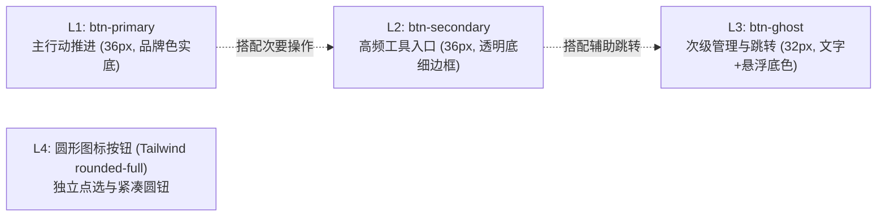
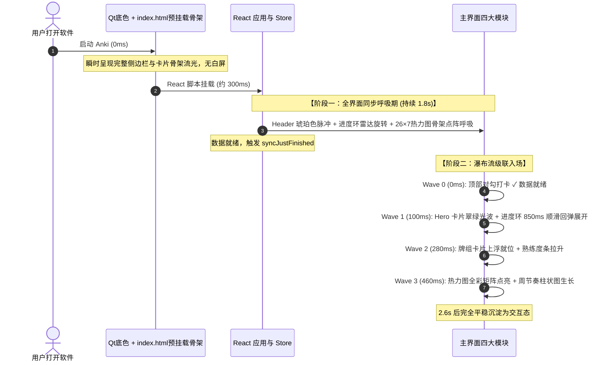

# Anki Studio — 设计规范与开发工程标准手册

> - **版本**：v1.5.8（与 `manifest.json` 的 `human_version` 对齐，改版时同步更新）
> - **适用范围**：Anki Studio 全局前端、Python 运行时、插件桥接与构建打包流水线
> - **核心原则**：保持 Apple 人机交互设计（HIG）质感、系统级流畅度与绝对代码健壮性。

---

## 目录

- [一、设计哲学与系统底色](#一定义设计哲学与系统底色)
- [二、UI 设计规范与 Design Tokens](#二ui-设计规范与-design-tokens)
  - [1. 色彩与主题矩阵（Light / Dark / OLED）](#1-色彩与主题矩阵light--dark--oled)
  - [2. 统一按钮四级体系（Button Hierarchy）](#2-统一按钮四级体系button-hierarchy)
  - [3. 容器、卡片与排版间距](#3-容器卡片与排版间距)
  - [4. 图标与 Emoji 防滥用规范](#4-图标与-emoji-防滥用规范)
  - [5. 动效与全局编排流水线（Two-Phase Motion）](#5-动效与全局编排流水线two-phase-motion)
  - [6. 悬浮提示与信息浮卡规范（Tooltip & HoverCard Standard）](#6-悬浮提示与信息浮卡规范tooltip--hovercard-standard)
- [三、前端开发与工程标准](#三前端开发与工程标准)
  - [1. 0 毫秒首帧绘制与防闪白架构（Zero White Flash）](#1-0-毫秒首帧绘制与防闪白架构zero-white-flash)
  - [2. 状态管理单一真实源（useSyncExternalStore）](#2-状态管理单一真实源usesyncexternalstore)
  - [3. Modern Web 性能与无障碍规范](#3-modern-web-性能与无障碍规范)
- [四、Python 后端与 IPC 桥接规范](#四python-后端与-ipc-桥接规范)
  - [1. 安全通信与数据路由（BridgeRouter）](#1-安全通信与数据路由bridgerouter)
  - [2. 三层防迷失安全网（Anti-Lost Safety Nets）](#2-三层防迷失安全网anti-lost-safety-nets)
  - [3. 原生 Qt 弹窗与光标静默拦截](#3-原生-qt-弹窗与光标静默拦截)
- [五、测试与构建打包红线](#五测试与构建打包红线)
- [六、休假守护与雪崩急救系统](#六休假守护与雪崩急救系统vacation--anti-burnout)
- [七、多助手协同开发与改动日志规范](#七多助手协同开发与改动日志规范multi-assistant-collaboration)

---

## 一、定义设计哲学与系统底色

Anki Studio 不做表层“换皮”，而是以现代桌面 OS（macOS Sonoma / Sequoia）的原生交互标准重构 Anki。

1. **沉浸式无缝体验**：
   - macOS 下通过 Cocoa 原生属性 `NSWindowStyleMaskFullSizeContentView` 融合原生红黄绿交通灯，窗口内容延伸至物理顶栏下方。
   - 顶部保留专属拖拽感应区（`startWindowDrag`），双击支持系统级窗口缩放（`handleWindowDoubleClick`），无违和感。
2. **克制温润的高级感**：
   - 杜绝突兀的高饱和撞色或大面积全屏遮罩；
   - 界面以卡片（Surfaces）为信息层级载体，借由发丝级细边框（Hairline Border）、环境漫反射投影与毛玻璃（Backdrop Blur）表达空间进深。
3. **闭环双向同步**：
   - 无论是卡片复习、新建牌组、编辑标签还是配置变更，均与 Anki 底层 SQLite 数据库和 AnkiWeb 云端完全同频。

---

## 二、UI 设计规范与 Design Tokens

### 1. 色彩与主题矩阵（Light / Dark / OLED）

系统原生支持三套主题与 **8 套强调色**，所有色值必须通过统一语义 Token 声明：

| 语义角色 | Light 模式 | Dark 模式 | OLED 纯黑模式 |
| :--- | :--- | :--- | :--- |
| **画布底色（`--bg-canvas`）** | `#F4F4F6` | `#131418` | `#09090C` |
| **主卡片背景（`--bg-card`）** | `#FFFFFF` | `#1A1B21` | `#111216` |
| **次级表面（`--bg-subtle`）** | `#F7F7F9` | `#20222A` | `#17181E` |
| **发丝边框（`--border-subtle`）** | `#EAECEF` | `#2A2C36` | `#22232B` |
| **高亮主文本（`--text-primary`）** | `#1D1D1F` | `#F2F3F7` | `#F4F4F6` |
| **正文次文本（`--text-secondary`）** | `#6E6E73` | `#B8BAC6` | `#B4B6C2` |
| **弱化说明文字（`--text-muted`）** | `#8E8E93` | `#A4A6B4` | `#9E9FAD` |

**浮层表面与高对比状态文本 Tokens（`index.css` / `themeTokens.ts`）**：

| Token | Light 模式 | Dark 模式 | OLED 纯黑模式 | 说明 |
| :--- | :--- | :--- | :--- | :--- |
| `--tooltip-bg` | `#FFFFFF` | `#23252E` | `#181A22` | 浮层抬升背景（高于 `--bg-card`） |
| `--tooltip-border` | `rgba(20, 24, 32, 0.10)` | `rgba(255, 255, 255, 0.11)` | `rgba(255, 255, 255, 0.12)` | 浮层描边 |
| `--tooltip-kbd-bg` / `-text` | `rgba(20, 24, 32, 0.06)` / `#4B4D54` | `rgba(255, 255, 255, 0.09)` / `#D2D5E0` | `rgba(255, 255, 255, 0.10)` / `#D6D9E4` | `<kbd>` 快捷键胶囊 |
| `--z-tooltip` | `9500` | `9500` | `9500` | 位于弹窗之上、Toast `9999` 之下 |
| `--status-danger-text` | `#C43643` | `#F27782` | `#F27782` | 小字高对比（>= 4.5:1） |
| `--status-warning-text` | `#A25810` | `#F0A854` | `#F0A854` | 小字高对比（>= 4.5:1） |
| `--status-success-text` | `#1F7A4D` | `#4CC38A` | `#4CC38A` | 小字高对比（>= 4.5:1） |
| `--status-info-text` | `#2266A3` | `#66ACEA` | `#66ACEA` | 小字高对比（>= 4.5:1） |

> JS 侧需读取状态文本色值时调用 `getStatusTextTokens(theme)`（`frontend/src/utils/themeTokens.ts`），保持 `buildThemeCssVars()` 返回集合稳定。

**强调色（Accent Colors，共 8 套，唯一真实源为 `frontend/src/utils/themeTokens.ts`）**：

| ID | 名称 | 品牌色 | 气质 |
| :--- | :--- | :--- | :--- |
| `indigo` | 经典蓝 · Studio Blue | `#3076C3` | Anki Studio 官方固定品牌色（默认） |
| `emerald` | 松石绿 · Sage | `#2F9461` | 护眼温润的自然鼠尾草与松林绿 |
| `cyan` | 雾海蓝 · Ocean | `#2B7ABF` | 清澈克制的北欧深海蓝 |
| `rose` | 赤陶粉 · Rose | `#C44D6C` | 柔和低饱和的复古赤陶灰粉 |
| `amber` | 琥珀金 · Ochre | `#C27429` | 知性温暖的秋日琥珀与羊皮纸色调 |
| `teal` | 峡湾青 · Fjord | `#23868C` | 冷静理性的蓝绿平衡色 |
| `violet` | 暮光紫 · Iris | `#7A50B6` | 优雅静谧的创意工作室紫晶色 |
| `slate` | 石墨灰 · Graphite | `#475569` | 纯粹无干扰的 Notion 极简黑白灰风格 |

> 首页牌组卡的颜色**由所选强调色派生**（同色系内做色相 ±13° 与深浅分级），不再按牌组序号
> 轮发彩虹色。派生规则与不变量见 `frontend/src/utils/deckPalette.ts`，并由
> `tests/frontend/specs/deckPalette.spec.ts` 守着「色相不出族」。

---

### 2. 统一按钮四级体系（Button Hierarchy）

全界面所有交互按钮统一划分为以下四级标准：



#### L1 Primary Button (`.btn-primary`)
- **使用场景**：每个页面的核心推进动作（如「▶ 开始今日学习」、「+ 新建牌组」、「保存卡片」）。
- **规格**：`height: 2.25rem (36px)`，`padding: 0 1rem (16px)`，`border-radius: 0.75rem (12px)`，`font-weight: 600`，字号 `0.75rem (12px)`。
- **视觉**：品牌强调色实底（`var(--brand)`）+ 白色文字 + `box-shadow: 0 1px 2px rgba(0, 0, 0, 0.08)`。
- **微动效**：悬浮提亮（`var(--brand-hover)` / `brightness(1.03)`）；点击按压 `scale: 0.98` 回弹；禁用降透明 `opacity: 0.45`。

#### L2 Secondary Button (`.btn-secondary`)
- **使用场景**：高频工具操作但非唯一核心（如侧边栏「+ 快速制卡」、空态「浏览卡片库」、弹窗「取消」）。
- **规格**：`height: 2.25rem (36px)`，`padding: 0 0.875rem (14px)`，`border-radius: 0.75rem (12px)`，`font-weight: 500`，字号 `0.75rem (12px)`。
- **视觉**：`background-color: transparent` + `border: 1px solid var(--border-subtle)`，文字为 `var(--text-primary)`。
- **微动效**：悬浮转为 `var(--brand-soft)` 底、`var(--brand-border)` 描边与 `var(--brand-text)`；点击按压 `scale: 0.98`。

#### L3 Ghost / Text Button (`.btn-ghost`)
- **使用场景**：辅助管理、列表右侧操作（如「全部牌组管理 ›」、「牌组重命名/删除」）。
- **规格**：`height: 2rem (32px)`，`padding: 0 0.625rem (10px)`，`border-radius: 0.5rem (8px)`，`font-weight: 500`，字号 `0.75rem (12px)`。
- **视觉**：默认透明底 + `var(--text-muted)`；悬浮后淡出 `var(--brand-soft)`，文字转为 `var(--brand-text)`。
- **微动效**：点击按压 `scale: 0.98`。

#### L4 圆形图标按钮（组合模式，无独立 `.btn-icon-circle` CSS 类）
- **使用场景**：卡片右下角播放钮、独立图标圆钮、弹窗角落关闭钮。
- **规格**：尺寸通常为 `28px`～`32px`，采用 `<button type="button">` 搭配 `rounded-full` 等 Tailwind 工具类实现，并必须配对 `aria-label` 与 `<Tooltip variant="compact">`。

> **规范红线**：
> 1. 按钮状态切换必须使用 `:hover:not(:disabled)`，严禁为 disabled 状态触发悬浮动效。
> 2. 必须保留 `:focus-visible` 统一双层焦点环（`outline: 2px solid var(--brand); outline-offset: 2px;`），保障键盘无障碍导航。**颜色必须走 `var(--brand)` 变量，不要写字面色值** —— accent 是用户可切换的 8 套色板之一（见 `frontend/src/utils/themeTokens.ts`），写死任何十六进制都会在换色后与界面其他部分脱节。

---

### 3. 容器、卡片与排版间距

- **主工作区内间距**：固定为 `px-8 py-6 space-y-6`（内边距 32px/24px，纵向间隔 24px）。
- **卡片圆角**：统一为 `rounded-2xl`（16px）；内边距统一为 `p-5` 或 `p-6`。
- **栅格规范**：
  - 牌组卡片流：`grid-cols-1 sm:grid-cols-2 md:grid-cols-3 lg:grid-cols-4 gap-4`；
  - 底部统计分析行：`grid-cols-12 gap-4`（热力图占 7 栏，复习节奏柱状图占 5 栏）；
  - 热力图点阵：`grid-cols-26 gap-1.5`（26 列 × 7 行，展现近 182 天连续心流）。

---

### 4. 图标与 Emoji 防滥用规范

- **严格禁止 Emoji 充当 UI 按钮或菜单图标**：严禁在菜单、标签页、卡片属性上随意堆砌 Emoji（如 📚 ⚙️ 🔍 ❌ 等），容易造成低幼感与跨平台渲染不一致。
- **唯一允许保留的 Emoji 业务场景**：
  - 连续打卡专属火焰：🔥（象征学习连击热情）；
  - 特殊空态艺术插画中作为视觉背景构图元素。
- **通用图标标准**：统一采用 Apple SF Symbols 风格的单线矢量 SVG 图标：
  - 描边线宽：`strokeWidth="2"` 或 `2.2`；
  - 端点风格：`strokeLinecap="round"`，`strokeLinejoin="round"`；
  - 默认尺寸：`w-3.5 h-3.5`（次要）、`w-4 h-4`（标准常规）、`w-5 h-5`（主视觉）。

---

### 5. 动效与全局编排流水线（Two-Phase Motion）

动效绝不可各个模块单兵作战、随意弹现，必须由全局时钟统一编排：



- **合成器线程铁律**：所有平主动效仅针对 `opacity`、`translate` 和 `scale` 属性进行动画，杜绝引发重排（Reflow）。
- **无障碍保护**：针对系统开启“减弱动态效果”的用户，在 `@media (prefers-reduced-motion: reduce)` 下强制将 `animation-duration` 与 `transition-duration` 压缩为 `0.01ms !important`（避免 `transitionend` 监听挂起），并禁用浮层位移动画（`transform: none !important`），以静态高对比呈现。

---

### 6. 悬浮提示与信息浮卡规范（Tooltip & HoverCard Standard）

全界面悬浮提示与信息浮卡收敛为一套统一 Portal 基础设施（`frontend/src/hooks/useFloatingPosition.ts`、`frontend/src/components/common/Tooltip.tsx`、`frontend/src/components/common/HoverCard.tsx`），禁止各业务组件再手写离散定位浮层或依赖原生 `title=`。

#### （1）两类原语 · 三级视觉规范

| 层级 | 组件与调用方式 | 适用场景 | 样式规格（`TOOLTIP_VARIANT_CLASSES` / `HOVERCARD_SIZE_CLASSES`） | 默认时序与指针行为 |
| :--- | :--- | :--- | :--- | :--- |
| **Compact** | `<Tooltip variant="compact">` | 图标按钮、快捷键说明、截断文本（配合 `onlyWhenTruncated`） | `rounded-[10px] px-2.5 py-1.5 text-[11px] font-medium leading-[1.35] max-w-[260px]`；可选 `<kbd className="ui-tooltip-kbd">` | `openDelay: 350ms`（300ms 热切换窗口内 `80ms`），`closeDelay: 80ms`，`closeOnClick: true`，`pointer-events-none` |
| **Chart** | `<Tooltip variant="chart">` / `<ChartTooltipPortal>` + `<ChartTooltipContent>` | 热力图（182 格建议单 Portal `ChartTooltipPortal`）、周节奏、预测/分布/留存/时段统计图 | `rounded-xl px-3 py-2 text-[11px] leading-[1.45] tabular-nums`；`ChartTooltipContent` 提供 `eyebrow`/`heading`/`rows`/`footer` | `openDelay: 0ms`，`closeDelay: 60ms`，`closeOnClick: false`，`pointer-events-none` |
| **HoverCard** | `<HoverCard size="sm \| md \| lg \| auto">` | 今日进度环、连胜说明、牌组熟练度拆解、同步状态详情等富交互浮卡 | `rounded-xl p-3 text-[11px] leading-[1.6]`；预设宽度 `sm: 220px` / `md: 248px` / `lg: 280px` | `openDelay: 180ms`（`:focus-visible` 与点击 `0ms`），`closeDelay: 150ms` 移入宽限，`toggleOnClick: true`，`pointer-events-auto` |

#### （2）Portal 分层、视口定位与 QtWebEngine 约束
- **Portal 与层级**：所有浮层统一通过 `createPortal(..., document.body)` 挂载，`z-index` 读取 `--z-tooltip: 9500`，严格高于 Modal（`z-50` / `z-[60]`）且低于全局 Toast（`z-[9999]`）与 `#fatal-error-overlay`（`999999`）。
- **测量与避让（`useFloatingPosition`）**：基于 `anchor.getBoundingClientRect()` 实测坐标，首帧先隐式布局再显示（无跳变），空间不足自动翻转对侧、钳位保留 `8px` 视口边距，监听 `ResizeObserver`、锚点断连（`isConnected`）及捕获阶段 `scroll`/`resize`。RTL 下自动识别 `dir="rtl"`（显式沿 `parentElement` 向上查找，**禁止 `.closest(`**）并映射 `start`/`end`。
- **QtWebEngine (Chrome/140) 兼容性**：Anki `26.09.4+` 内嵌 `Chrome/140`，**严禁**依赖 HTML `interestfor`（Chrome 149+）、`popover="hint"`（Chrome 151+）或 CSS `@container anchored(...)`（Chrome 143+）；所有定位、悬停热窗与外部点击关闭均由 `useFloatingPosition` / `HoverCard` + `getClosestFromTarget` 兜底。

#### （3）色彩对比、快捷键与无障碍红线（WCAG 1.4.13）
- **文本高对比**：`--tooltip-bg` 上展示 `11px` 数字或状态标签时，**禁止**直接使用低对比背景色标（如 `accentScale.heatmap[1]/[2]`、`brandHex` 或 `#FF9F0A`）作为文字色；必须使用 `ChartTooltipContent` 的 `tone` 映射或 `--text-primary` / `--text-secondary` / `--brand-text` / `--status-*-text`（Light `#A25810` 等，>= 4.5:1）。
- **快捷键格式**：必须向 `<Tooltip shortcut="...">` 传逻辑键（如 `"Cmd+K"`、`"Esc"`），由组件内部调用 `formatShortcut(..., envInfo.platform)` 并尊重 `useAppStore().showShortcutHints`；**禁止**在多语言字典或提示里硬编码单平台 `Cmd`（`test_frontend_bundle.mjs` Item #40）。
- **键盘模态与播报去重**：
  - 通过 `ensureInputModalityListener` / `isElementFocusVisible` 区分键盘 Tab 聚焦与鼠标点击，杜绝鼠标点击按钮后残留焦点 Tooltip；`Escape` 可不移动焦点直接关闭任何浮层；`HoverCard` 点击可钉住并支持外部指针点击关闭（须经 `domTarget.ts` 的 `getClosestFromTarget`）。
  - `Tooltip` 默认 `ariaLabelMode="auto"`：当子元素已有与纯文本 `content` 完全一致的 `aria-label` 且无额外 `<kbd>` 时，浮层自动标 `aria-hidden="true"` 避免重复朗读；其余补充场景附带 `role="tooltip"` + `aria-describedby`。
  - 弹窗关闭按钮 `✕` 统一规范为 `<Tooltip variant="compact" content={t('close')} shortcut="Esc">` 搭配 `aria-label={t('close')}`；原生 `disabled` 按钮由 `renderAnchoredTrigger` 自动外包 `<span>` 并在内层设置 `pointerEvents: 'none'` 以保留提示。
- **原生 `title=` 与 SSR 铁律**：
  - 前端 `.tsx` 组件**严禁**残留原生 `title=`（仅 `<iframe title=...>` 无障碍容器标题例外，如 `SandboxCardFrame.tsx`；Python/Qt 宿主菜单与原生工具栏 `setToolTip` / `tip=` 在 `__init__.py` 单独本地化管理）。
  - 所有定位与浮层组件必须守卫 `typeof document !== 'undefined'` / `typeof window !== 'undefined'`，保障 `tests/frontend/run.mjs` 的 `renderToStaticMarkup` SSR 渲染零异常。

---

## 三、前端开发与工程标准

### 1. 0 毫秒首帧绘制与防闪白架构（Zero White Flash）

消灭启动白屏必须“双管齐下”，缺少任一层都会导致闪烁：

1. **Qt 引擎底层预注入（Python 层）**：
   ```python
   # __init__.py
   bg_hex = "#16161A" if cfg.get("theme") in ("dark", "oled") else "#F4F4F6"
   if page and hasattr(page, "setBackgroundColor"):
       page.setBackgroundColor(QColor(bg_hex))
   ```
2. **HTML 预挂载骨架结构（HTML 层）**：
   - 在 `frontend/index.html` 的 `<head>` 中内联关键 CSS 变量；
   - 在 `<div id="root">` 内部直接预先写入与真实界面 1:1 对齐的静态 CSS 骨架网格（`premount-shell`）。
   - Chromium 引擎完成 HTML 解析的第 1 毫秒即绘制骨架，React 挂载后直接平滑替换。

### 2. 状态管理单一真实源（useSyncExternalStore）

- **数据源唯一性**：全局状态集中收敛在 [`frontend/src/stores/useAppStore.ts`](../frontend/src/stores/useAppStore.ts)。
- **外部与事件读取规范**：
  - 组件内部：使用 Hook `const { ... } = useAppStore()` 响应式监听；
  - 事件监听器、异步回调或外部函数：统一调用 `getAppState()` 读取最新即时快照，**严禁** 在外部调用组件 Hook。
- **并发锁与防中断保护**：
  - 冷启动期间设置 `coldStartInProgress` 标记，在此期间拦截非必要的静默更新（`silent=true`），杜绝动画被腰斩。
- **Effect 依赖铁律**：
  - 启动挂载 Effect 依赖数组必须声明为 `[]`（仅挂载一次），严禁将 Effect 自身会修改的属性（如 `resolvedLang`）放入依赖，以防死循环。

### 3. Modern Web 性能与无障碍规范

- **语义化标签**：进度展示采用 `<div role="progressbar" aria-valuenow={...}>`，按钮严格采用 `<button type="button">`。
- **弹窗与覆盖层**：使用 `overscroll-behavior: contain` 阻断弹窗背后的页面滚动穿透。
- **浮动提示层（Tooltip & HoverCard）**：严禁使用原生 HTML `title=`；全界面统一采用基于 `document.body` Portal + `getBoundingClientRect()` 的 `<Tooltip>` / `<ChartTooltipPortal>` / `<HoverCard>`（见 [二.6 悬浮提示与信息浮卡规范](#6-悬浮提示与信息浮卡规范tooltip--hovercard-standard)），兼容 QtWebEngine `Chrome/140`，不引入第三方浮层重依赖。

---

## 四、Python 后端与 IPC 桥接规范

### 1. 安全通信与数据路由（BridgeRouter）

- **统一前缀**：所有 JavaScript 向 Python 发送的命令必须以 `modern_anki:` 为前缀：
  ```ts
  // 前端
  await callAnki<DashboardData>('get_dashboard', { ... });
  ```
- **路由分发**：Python 端由 [`bridge/router.py`](../bridge/router.py) 进行方法分发，所有公开 API 方法必须返回符合 JSON 规范的字典或基本类型，且显式捕获内部异常，严禁向前端抛出未格式化的 Python Traceback。
- **卡面样式必须按面分离（正 / 反双作用域）**：卡包模板普遍用 `display:none` / `{{hint}}` 把详解、扩展例句、提示藏在正面、靠脚本或点击展开。因此：
  - **正面**用 `reveal_hidden=False` 生成、作用域为 `.anki-native-card-front` 的 CSS，并保留 `{{hint}}` 的 `display:none`；
  - **背面**用 `reveal_hidden=True`、作用域为 `.anki-native-card` 的 CSS，把隐藏内容揭开（WebView 不执行模板脚本，不揭开则永远不可达）；
  - **任何新增卡面渲染面（复习 / 搜索结果 / Cmd+K 预览 / 编辑器）都必须按面取对应 CSS，禁止正反共用一份**；两面同屏时两个作用域互不覆盖。当前本机实测 36 个卡型里 10 个（约 25% 的卡）在正面使用了这类隐藏。
- **运行时兼容性自检**：为了沉浸感而接管 Anki/Qt 私有接口（进度弹窗、tooltip、Preferences、同步错误）的每一处 patch 都自带 `try/except`，失败时**不会崩、但会静默降级**。因此 [`bridge/compat.py`](../bridge/compat.py) 在启动后汇总「Anki 版本是否达标 + 4 个补丁 + 8 个生命周期钩子」的生效状态，降级时在 Anki 控制台打印 `patch health` 报告，前端也可通过 IPC action `get_patch_health` 读取同一份结构化报告（含 `state: ok|degraded` 与逐条原因）。**新增 patch 或钩子时必须同步更新 `PATCH_SPECS` / `HOOK_SPECS`，否则自检会漏报。**

### 2. 三层防迷失安全网（Anti-Lost Safety Nets）

为了防止用户“进得去、出不来”，架构上实现了三重安全兜底：

1. **第一层：系统级安全快捷键**：
   - macOS：`Ctrl+Opt+M` / `Meta+Alt+M`
   - Windows / Linux：`Ctrl+Alt+M`
   - 在任何视图（甚至崩溃态）均可一键在 Anki Studio 与 Anki 原生界面间自由切换。
2. **第二层：原生菜单栏入口**：
   - Anki 顶层菜单「工具 (Tools)」中常驻「切换 Anki Studio / 原生界面」。
3. **第三层：原生顶栏胶囊**：
   - 切换至原生界面时，自动在 Anki 顶部工具栏（`mw.toolbar`）追加显著的彩色胶囊按钮 `[ 🌟 进入 Anki Studio ]`。

### 3. 原生 Qt 弹窗与光标静默拦截

- **抑制漏斗光标**：在 Modern UI 激活期间，静默屏蔽原生 Qt `WaitCursor`（黑白四象限漏斗圈），由前端统一使用平滑的矢量 SVG 转圈。
- **抑制黄色原生 Tooltip 浮层**：原生 `aqt.utils.tooltip` 弹出的黄色方块在现代 UI 下极度破坏沉浸感，Modern UI 激活期间自动拦截原生 Tooltip，转化为顶栏灵动胶囊或前端 Toast，并自动过滤「集合同步完成」等重复消息。

---

## 五、测试与构建打包红线

任何日常开发、界面微调或重构，均须遵守以下工程流水线红线：

```bash
# 1. 编译前端生产静态资源（web/ 与源码必须同步）
cd frontend && npm run build

# 2. 前端字符串审计：护栏 / IPC 协议 / CSS 规范 / i18n（ALL CHECKS PASSED）
node tests/test_frontend_bundle.mjs

# 3. 前端单元套件：纯逻辑 + 叶子组件渲染（67 项，见 tests/frontend/README.md）
node tests/frontend/run.mjs

# 4. Python 单测：桥接层、卡片安全、发布不变量、兼容性自检与通用修复（当前 122 项）
python3 -m unittest discover -s tests -p "test_*.py"

# 5. （改到业务逻辑时）隔离场景冒烟：11 个场景 / 692 项检查，不动真实数据
cd tests/scenarios && ./gate.sh

# 6. （可选，本地有卡组时）真实 .apkg 显示兼容性：17 个 AnkiWeb 卡组 / 约 16 秒
python3 tests/apkg/run.py

# 7. 产出最终可发布的 Anki Addon 标准归档
python3 scripts/build_ankiaddon.py
```

> **门禁语义**：第 2、3、4 步必须全绿（`ALL CHECKS PASSED` / `OK`）才能交付；第 5 步在改动
> 桥接层业务逻辑时必跑。前端字符串审计保证「护栏还在」，前端单元套件保证「算得对」，两者
> 不可互相替代。
>
> **已知盲区**：组件的交互（点击、拖拽、弹窗焦点、iframe 沙盒通信）目前只有
> `tests/scenarios/` 的场景库 + 手工目视，没有自动化 DOM 测试；新增交互逻辑时请在
> `tests/frontend/specs/render.spec.tsx` 至少补一条静态渲染断言（如 `<Tooltip>` / `<HoverCard>`
> SSR 冒烟），并确保通过 `frontend_audit.py` 的原生 `title=` 回归检查与 `test_frontend_bundle.mjs`
> 统一浮层护栏（Item #36 / #49）。

---

## 六、休假守护与雪崩急救系统（Vacation & Anti-Burnout）

为了终结 Anki 原生因现实生活突发事件（值班、出差、突击考试、大病）导致的“卡片雪崩与心理弃坑”，Anki Studio 架构内建了完整的认知减压与科学调度引擎：

### 1. 🌴 事前请假模式（Vacation Mode）
- **核心服务**：[`bridge/vacation_service.py`](../bridge/vacation_service.py)
- **三维保护机制**：
  1. **新卡投放冻结**：休假期间将所有活跃牌组配置中的每日新卡限额临时置为 0，防止积压持续扩大，休假结束后自动无损复原。
  2. **到期日平稳顺延**：调用底层 `col.sched.set_due_date` 将到期卡片后移 $N$ 天，仅平移日程，100% 保护已有记忆间隔（Interval）权重。
  3. **打卡连胜冰冻（Streak Freeze）**：在热力图与连续打卡统计中，将休假区间内的日期标记为 `isStreakFrozen: true`，算法自动跨越休假日桥接连续打卡，守护学习者的心智成就感。

### 2. 🚑 事后雪崩急救（Anti-Avalanche & Amortization）
当用户因突发状况未能提前请假、数天后打开软件面临数十/数百张积压卡片时：
- **方案 A · 削峰填谷（Amortize & Flatten，最推荐）**：
  通过 `col.sched.set_due_date(card_ids, f"1-{days}")`，在未来 $K$ 天（如 3/7/14 天）内将积压卡片均匀打散穿插，平均每天仅增加微量负担，无痛消化。
- **方案 B · 整体顺延（Shift Due Dates）**：
  将所有积压卡片整体推迟 $N$ 天，相当于将耽误的时间整体平移，当天零负担重启。

### 3. ☕️ 低能量极简打卡模式（Low-Energy Mode）
在身体极度疲惫或精力见底时，提供一键筛选前 15 张最高成熟度/最熟悉卡片的极简队列，轻松通关打卡，捍卫“每天打开 Anki”的原子微习惯。

---

## 七、多助手协同开发与改动日志规范（Multi-Assistant Collaboration）

本项目由多位 AI 助手（包括 Gemini、Antigravity、Claude 等）和人类开发者以敏捷结对模式协同推进。为了防止不同助手在不同会话中产生信息孤岛、代码覆盖或破坏既有设计规范，所有参与开发的助手必须严格执行以下协同协议：

### 1. 强制前置检查（Pre-Task Invariant）
在开始分析用户需求或编写任何代码前，助手必须执行：
1. **查阅改动日志**：阅读根目录下的 [`CHANGELOG.md`](../CHANGELOG.md)，确认最近几次提交/修改的具体内容、所涉文件及不变式（Invariants）。
2. **确认当前代码状态**：检查上一位助手的构建产物、测试用例与改动状态，避免盲目猜测。

### 2. 强制后置记录（Post-Task Invariant）
在完成任何新功能、Bug 修复、样式微调或重构后，助手必须执行：
1. **登记 CHANGELOG.md**：在 `CHANGELOG.md` 顶部的最新版本或 `[Unreleased]` 区域追加条目，包含：
   - 助手标签：如 `[Gemini]`、`[Antigravity]`；
   - 变更简述：改动的核心原因与解决的用户痛点；
   - 影响文件清单：精确列出修改的文件相对路径。
2. **执行双重验证门禁**：
   - 运行前端与护栏自动化测试：`node tests/test_frontend_bundle.mjs`
   - 运行 Python IPC 单元测试：`python3 -m unittest discover -s tests -p "test_*.py"`
   - 编译前端静态资源：`cd frontend && npm run build`
3. **维护 Git 提交历史**：对本次改动建立清晰、语义化的 Git Commit 记录，确保版本追踪可溯源。
