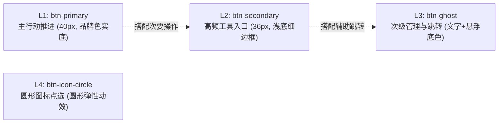
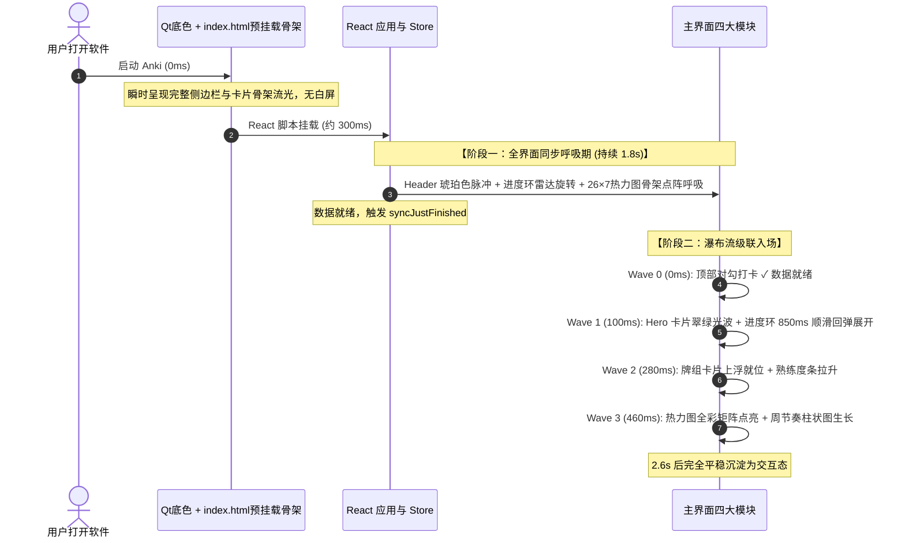

# Anki Studio — 设计规范与开发工程标准手册

> **版本**：v1.2.0  
> **适用范围**：Anki Studio 全局前端、Python 运行时、插件桥接与构建打包流水线  
> **核心原则**：保持 Apple 人机交互设计（HIG）质感、系统级流畅度与绝对代码健壮性。

---

## 目录

- [一、设计哲学与系统底色](#一定义设计哲学与系统底色)
- [二、UI 设计规范与 Design Tokens](#二ui-设计规范与-design-tokens)
  - [1. 色彩与主题矩阵（Light / Dark / OLED）](#1-色彩与主题矩阵light--dark--oled)
  - [2. 统一按钮四级体系（Button Hierarchy）](#2-统一按钮四级体系button-hierarchy)
  - [3. 容器、卡片与排版间距](#3-容器卡片与排版间距)
  - [4. 图标与 Emoji 防滥用规范](#4-图标与-emoji-防滥用规范)
  - [5. 动效与全局编排流水线（Two-Phase Motion）](#5-动效与全局编排流水线two-phase-motion)
- [三、前端开发与工程标准](#三前端开发与工程标准)
  - [1. 0 毫秒首帧绘制与防闪白架构（Zero White Flash）](#1-0-毫秒首帧绘制与防闪白架构zero-white-flash)
  - [2. 状态管理单一真实源（useSyncExternalStore）](#2-状态管理单一真实源usesyncexternalstore)
  - [3. Modern Web 性能与无障碍规范](#3-modern-web-性能与无障碍规范)
- [四、Python 后端与 IPC 桥接规范](#四python-后端与-ipc-桥接规范)
  - [1. 安全通信与数据路由（BridgeRouter）](#1-安全通信与数据路由bridgerouter)
  - [2. 三层防迷失安全网（Anti-Lost Safety Nets）](#2-三层防迷失安全网anti-lost-safety-nets)
  - [3. 原生 Qt 弹窗与光标静默拦截](#3-原生-qt-弹窗与光标静默拦截)
- [五、测试与构建打包红线](#五测试与构建打包红线)
- [六、休假守护与雪崩急救系统](#六休假守护与雪崩急救系统vacation--anti-burnout)
- [七、多助手协同开发与改动日志规范](#七多助手协同开发与改动日志规范multi-assistant-collaboration)

---

## 一、定义设计哲学与系统底色

Anki Studio 不做表层“换皮”，而是以现代桌面 OS（macOS Sonoma / Sequoia）的原生交互标准重构 Anki。

1. **沉浸式无缝体验**：
   - macOS 下通过 Cocoa 原生属性 `NSWindowStyleMaskFullSizeContentView` 融合原生红黄绿交通灯，窗口内容延伸至物理顶栏下方。
   - 顶部保留专属拖拽感应区（`startWindowDrag`），双击支持系统级窗口缩放（`handleWindowDoubleClick`），无违和感。
2. **克制温润的高级感**：
   - 杜绝突兀的高饱和撞色或大面积全屏遮罩；
   - 界面以卡片（Surfaces）为信息层级载体，借由发丝级细边框（Hairline Border）、环境漫反射投影与毛玻璃（Backdrop Blur）表达空间进深。
3. **闭环双向同步**：
   - 无论是卡片复习、新建牌组、编辑标签还是配置变更，均与 Anki 底层 SQLite 数据库和 AnkiWeb 云端完全同频。

---

## 二、UI 设计规范与 Design Tokens

### 1. 色彩与主题矩阵（Light / Dark / OLED）

系统原生支持三套主题与四种强调色，所有色值必须通过统一语义 Token 声明：

| 语义角色 | Light 模式 | Dark 模式 | OLED 纯黑模式 |
| :--- | :--- | :--- | :--- |
| **画布底色（App Canvas）** | `#F4F4F6` | `#16161A` | `#08080A` |
| **主卡片背景（Card Surface）** | `#FFFFFF` | `#1C1C22` | `#121216` |
| **侧边栏背景（Sidebar Surface）** | `#FFFFFF` | `#131317` | `#08080A` |
| **卡片发丝边框（Card Border）** | `#EBEBF0` | `#2C2C35` | `#22222A` |
| **次级说明文字（Muted Text）** | `#8E8E93` | `#8E8E93` | `#8E8E93` |
| **高亮主文本（Primary Text）** | `#1D1D1F` | `#F5F5F7` | `#FFFFFF` |

**强调色（Accent Colors）**：
- **Indigo**：`#5E5CE6`（默认，经典灵动紫）
- **Cyan**：`#007AFF`（专业科技蓝）
- **Emerald**：`#28CD41`（清晰活力绿）
- **Rose**：`#FF375F`（典雅玫瑰红）

---

### 2. 统一按钮四级体系（Button Hierarchy）

全界面所有交互按钮统一划分为以下四级标准：



#### L1 Primary Button (`.btn-primary`)
- **使用场景**：每个页面的核心推进动作（如「▶ 开始今日学习」、「+ 新建牌组」、「保存卡片」）。
- **规格**：`height: 40px (h-10)`，`padding-inline: 20px (px-5)`，`border-radius: 12px (rounded-xl)`，`font-weight: 600`，字号 `13px`。
- **视觉**：品牌强调色实底 + 白色文字 + `box-shadow: 0 2px 8px rgba(94, 92, 230, 0.22)`。
- **微动效**：悬浮微上浮 `translate: 0 -1px` + 投影放大；点击按压 `scale: 0.98` 回弹。

#### L2 Secondary Button (`.btn-secondary`)
- **使用场景**：高频工具操作但非唯一核心（如侧边栏「+ 快速制卡」、空态「浏览卡片库」、弹窗「取消」）。
- **规格**：`height: 36px (h-9)`，`padding-inline: 16px (px-4)`，`border-radius: 12px (rounded-xl)`，`font-weight: 500`，字号 `13px`。
- **视觉**：浅色 `#F6F6F9`（深色 `rgba(255, 255, 255, 0.06)`）+ `1px` 微弱边框，文字为当前主题正文色。
- **微动效**：悬浮柔和加深背景；点击按压 `scale: 0.98`。

#### L3 Ghost / Text Button (`.btn-ghost`)
- **使用场景**：辅助管理、列表右侧操作（如「全部牌组管理 ›」、「牌组重命名/删除」）。
- **规格**：默认无底色无描边，内衬垫 `padding: 4px 10px (px-2.5 py-1)`，`border-radius: 8px (rounded-lg)`，字号 `12px`。
- **视觉**：默认次级灰 `#8E8E93`；悬浮后背景淡出浅紫/浅灰，文字转为品牌高亮。
- **微动效**：点击按压 `scale: 0.97`。

#### L4 Icon Circle Button (`.btn-icon-circle`)
- **使用场景**：卡片右下角的播放按钮、独立圆钮。
- **规格**：`28px` 或 `30px`，`border-radius: 9999px (全圆)`。
- **微动效**：悬浮放大 `scale: 1.1`，点击按压 `scale: 0.92`。

> **规范红线**：
> 1. 按钮状态切换必须使用 `:hover:not(:disabled)`，严禁为 disabled 状态触发悬浮动效。
> 2. 必须保留 `:focus-visible` 统一双层焦点环（`outline: 2px solid #5E5CE6; outline-offset: 2px;`），保障键盘无障碍导航。

---

### 3. 容器、卡片与排版间距

- **主工作区内间距**：固定为 `px-8 py-6 space-y-6`（内边距 32px/24px，纵向间隔 24px）。
- **卡片圆角**：统一为 `rounded-2xl`（16px）；内边距统一为 `p-5` 或 `p-6`。
- **栅格规范**：
  - 牌组卡片流：`grid-cols-1 sm:grid-cols-2 md:grid-cols-3 lg:grid-cols-4 gap-4`；
  - 底部统计分析行：`grid-cols-12 gap-4`（热力图占 7 栏，复习节奏柱状图占 5 栏）；
  - 热力图点阵：`grid-cols-26 gap-1.5`（26 列 × 7 行，展现近 182 天连续心流）。

---

### 4. 图标与 Emoji 防滥用规范

- **严格禁止 Emoji 充当 UI 按钮或菜单图标**：严禁在菜单、标签页、卡片属性上随意堆砌 Emoji（如 📚 ⚙️ 🔍 ❌ 等），容易造成低幼感与跨平台渲染不一致。
- **唯一允许保留的 Emoji 业务场景**：
  - 连续打卡专属火焰：🔥（象征学习连击热情）；
  - 特殊空态艺术插画中作为视觉背景构图元素。
- **通用图标标准**：统一采用 Apple SF Symbols 风格的单线矢量 SVG 图标：
  - 描边线宽：`strokeWidth="2"` 或 `2.2`；
  - 端点风格：`strokeLinecap="round"`，`strokeLinejoin="round"`；
  - 默认尺寸：`w-3.5 h-3.5`（次要）、`w-4 h-4`（标准常规）、`w-5 h-5`（主视觉）。

---

### 5. 动效与全局编排流水线（Two-Phase Motion）

动效绝不可各个模块单兵作战、随意弹现，必须由全局时钟统一编排：



- **合成器线程铁律**：所有平主动效仅针对 `opacity`、`translate` 和 `scale` 属性进行动画，杜绝引发重排（Reflow）。
- **无障碍保护**：针对系统开启“减弱动态效果”的用户，在 `@media (prefers-reduced-motion: reduce)` 下强制将过渡时间降为 0，直接以静态高对比呈现。

---

## 三、前端开发与工程标准

### 1. 0 毫秒首帧绘制与防闪白架构（Zero White Flash）

消灭启动白屏必须“双管齐下”，缺少任一层都会导致闪烁：

1. **Qt 引擎底层预注入（Python 层）**：
   ```python
   # __init__.py
   bg_hex = "#16161A" if cfg.get("theme") in ("dark", "oled") else "#F4F4F6"
   if page and hasattr(page, "setBackgroundColor"):
       page.setBackgroundColor(QColor(bg_hex))
   ```
2. **HTML 预挂载骨架结构（HTML 层）**：
   - 在 `frontend/index.html` 的 `<head>` 中内联关键 CSS 变量；
   - 在 `<div id="root">` 内部直接预先写入与真实界面 1:1 对齐的静态 CSS 骨架网格（`premount-shell`）。
   - Chromium 引擎完成 HTML 解析的第 1 毫秒即绘制骨架，React 挂载后直接平滑替换。

### 2. 状态管理单一真实源（useSyncExternalStore）

- **数据源唯一性**：全局状态集中收敛在 [`frontend/src/stores/useAppStore.ts`](file:///Users/gripet/Library/Application%20Support/Anki2/addons21/anki_modern_os/frontend/src/stores/useAppStore.ts)。
- **外部与事件读取规范**：
  - 组件内部：使用 Hook `const { ... } = useAppStore()` 响应式监听；
  - 事件监听器、异步回调或外部函数：统一调用 `getAppState()` 读取最新即时快照，**严禁** 在外部调用组件 Hook。
- **并发锁与防中断保护**：
  - 冷启动期间设置 `coldStartInProgress` 标记，在此期间拦截非必要的静默更新（`silent=true`），杜绝动画被腰斩。
- **Effect 依赖铁律**：
  - 启动挂载 Effect 依赖数组必须声明为 `[]`（仅挂载一次），严禁将 Effect 自身会修改的属性（如 `resolvedLang`）放入依赖，以防死循环。

### 3. Modern Web 性能与无障碍规范

- **语义化标签**：进度展示采用 `<div role="progressbar" aria-valuenow={...}>`，按钮严格采用 `<button type="button">`。
- **弹窗与覆盖层**：使用 `overscroll-behavior: contain` 阻断弹窗背后的页面滚动穿透。
- **浮动提示层（Tooltip）**：热力图与周节奏柱状图使用绝对定位与实时感知计算（`pointer-events-none`），悬浮即现、移出即消，不引入复杂第三方大体积依赖。

---

## 四、Python 后端与 IPC 桥接规范

### 1. 安全通信与数据路由（BridgeRouter）

- **统一前缀**：所有 JavaScript 向 Python 发送的命令必须以 `modern_anki:` 为前缀：
  ```ts
  // 前端
  await callAnki<DashboardData>('get_dashboard', { ... });
  ```
- **路由分发**：Python 端由 [`bridge/router.py`](file:///Users/gripet/Library/Application%20Support/Anki2/addons21/anki_modern_os/bridge/router.py) 进行方法分发，所有公开 API 方法必须返回符合 JSON 规范的字典或基本类型，且显式捕获内部异常，严禁向前端抛出未格式化的 Python Traceback。

### 2. 三层防迷失安全网（Anti-Lost Safety Nets）

为了防止用户“进得去、出不来”，架构上实现了三重安全兜底：

1. **第一层：系统级安全快捷键**：
   - macOS：`Ctrl+Opt+M` / `Meta+Alt+M`
   - Windows / Linux：`Ctrl+Alt+M`
   - 在任何视图（甚至崩溃态）均可一键在 Anki Studio 与 Anki 原生界面间自由切换。
2. **第二层：原生菜单栏入口**：
   - Anki 顶层菜单「工具 (Tools)」中常驻「切换 Anki Studio / 原生界面」。
3. **第三层：原生顶栏胶囊**：
   - 切换至原生界面时，自动在 Anki 顶部工具栏（`mw.toolbar`）追加显著的彩色胶囊按钮 `[ 🌟 进入 Anki Studio ]`。

### 3. 原生 Qt 弹窗与光标静默拦截

- **抑制漏斗光标**：在 Modern UI 激活期间，静默屏蔽原生 Qt `WaitCursor`（黑白四象限漏斗圈），由前端统一使用平滑的矢量 SVG 转圈。
- **抑制黄色原生 Tooltip 浮层**：原生 `aqt.utils.tooltip` 弹出的黄色方块在现代 UI 下极度破坏沉浸感，Modern UI 激活期间自动拦截原生 Tooltip，转化为顶栏灵动胶囊或前端 Toast，并自动过滤「集合同步完成」等重复消息。

---

## 五、测试与构建打包红线

任何日常开发、界面微调或重构，均须遵守以下工程流水线红线：

```bash
# 1. 编译前端生产静态资源
cd frontend && npm run build

# 2. 执行自动化体检套件（涵盖护栏检查、TypeScript 编译验证、Token完整性）
node tests/test_frontend_bundle.mjs

# 3. 产出最终可发布的 Anki Addon 标准归档
python3 scripts/build_ankiaddon.py
```

> **自动化测试规范**：`tests/test_frontend_bundle.mjs` 作为发布前的门禁守卫，必须确保所有核心导出项、双向通信协议与 CSS 规范 100% 通过（`ALL CHECKS PASSED`）后方可交付。

---

## 六、休假守护与雪崩急救系统（Vacation & Anti-Burnout）

为了终结 Anki 原生因现实生活突发事件（值班、出差、突击考试、大病）导致的“卡片雪崩与心理弃坑”，Anki Studio 架构内建了完整的认知减压与科学调度引擎：

### 1. 🌴 事前请假模式（Vacation Mode）
- **核心服务**：[`bridge/vacation_service.py`](file:///Users/gripet/Library/Application%20Support/Anki2/addons21/anki_modern_os/bridge/vacation_service.py)
- **三维保护机制**：
  1. **新卡投放冻结**：休假期间将所有活跃牌组配置中的每日新卡限额临时置为 0，防止积压持续扩大，休假结束后自动无损复原。
  2. **到期日平稳顺延**：调用底层 `col.sched.set_due_date` 将到期卡片后移 $N$ 天，仅平移日程，100% 保护已有记忆间隔（Interval）权重。
  3. **打卡连胜冰冻（Streak Freeze）**：在热力图与连续打卡统计中，将休假区间内的日期标记为 `isStreakFrozen: true`，算法自动跨越休假日桥接连续打卡，守护学习者的心智成就感。

### 2. 🚑 事后雪崩急救（Anti-Avalanche & Amortization）
当用户因突发状况未能提前请假、数天后打开软件面临数十/数百张积压卡片时：
- **方案 A · 削峰填谷（Amortize & Flatten，最推荐）**：
  通过 `col.sched.set_due_date(card_ids, f"1-{days}")`，在未来 $K$ 天（如 3/7/14 天）内将积压卡片均匀打散穿插，平均每天仅增加微量负担，无痛消化。
- **方案 B · 整体顺延（Shift Due Dates）**：
  将所有积压卡片整体推迟 $N$ 天，相当于将耽误的时间整体平移，当天零负担重启。

### 3. ☕️ 低能量极简打卡模式（Low-Energy Mode）
在身体极度疲惫或精力见底时，提供一键筛选前 15 张最高成熟度/最熟悉卡片的极简队列，轻松通关打卡，捍卫“每天打开 Anki”的原子微习惯。

---

## 七、多助手协同开发与改动日志规范（Multi-Assistant Collaboration）

本项目由多位 AI 助手（包括 Gemini、Antigravity、Claude 等）和人类开发者以敏捷结对模式协同推进。为了防止不同助手在不同会话中产生信息孤岛、代码覆盖或破坏既有设计规范，所有参与开发的助手必须严格执行以下协同协议：

### 1. 强制前置检查（Pre-Task Invariant）
在开始分析用户需求或编写任何代码前，助手必须执行：
1. **查阅改动日志**：阅读根目录下的 [`CHANGELOG.md`](../CHANGELOG.md)，确认最近几次提交/修改的具体内容、所涉文件及不变式（Invariants）。
2. **确认当前代码状态**：检查上一位助手的构建产物、测试用例与改动状态，避免盲目猜测。

### 2. 强制后置记录（Post-Task Invariant）
在完成任何新功能、Bug 修复、样式微调或重构后，助手必须执行：
1. **登记 CHANGELOG.md**：在 `CHANGELOG.md` 顶部的最新版本或 `[Unreleased]` 区域追加条目，包含：
   - 助手标签：如 `[Gemini]`、`[Antigravity]`；
   - 变更简述：改动的核心原因与解决的用户痛点；
   - 影响文件清单：精确列出修改的文件相对路径。
2. **执行双重验证门禁**：
   - 运行前端与护栏自动化测试：`node tests/test_frontend_bundle.mjs`
   - 运行 Python IPC 单元测试：`python3 -m unittest discover -s tests -p "test_*.py"`
   - 编译前端静态资源：`cd frontend && npm run build`
3. **维护 Git 提交历史**：对本次改动建立清晰、语义化的 Git Commit 记录，确保版本追踪可溯源。
