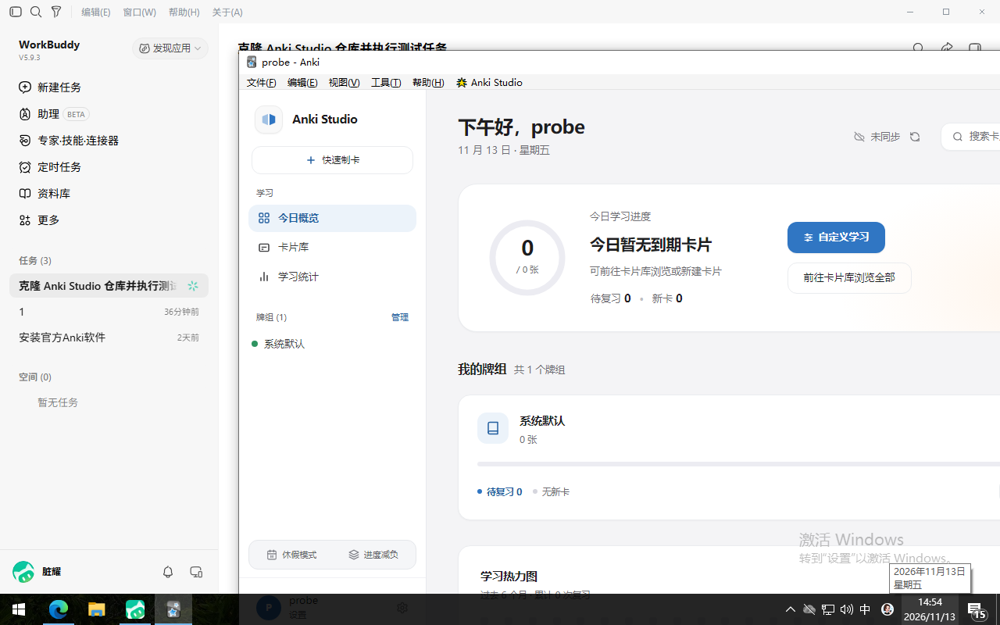

# Anki Studio 历史版本兼容性验证（Windows，2026-11-13）

插件版本：1.4.0（仓库 `3a4495d`，`manifest.json` 里 `min_point_version = 260904`）
测试机：Windows 10 22H2（QEMU 虚拟机，1280×800 @96dpi）
基线：本机已装 Anki 26.09.4 / Python 3.13.17 / Qt 6.11.2

本轮的驱动与诊断 addon 全部放在 `~/Anki-Test-Env/compat/`，**不在仓库内、不改产品代码**。

---

## 一、结论摘要

| 问题 | 结论 |
|---|---|
| `min_point_version = 260904` 能否阻止旧版加载？ | **不能**。文件夹直装时该字段完全不参与加载判断，260905 也照常加载 |
| 那它到底控制什么？ | 只控制插件列表里的「需要 Anki >= x.y」标注，且该标注读的是 `meta.json`，不读 `manifest.json` |
| 插件实际能跑到多老？ | **24.06.3**（本次最老版本），12 个核心 action 全通，webview 正常挂载，UI 完整渲染 |
| 四个版本有 API 差异吗？ | **没有**。26.09.4 / 25.02.7 / 24.11 / 24.06.3 的探针结果逐项一致 |

## 二、版本矩阵与安装方式

| 版本 | point | 安装包 | 大小 (B) | SHA-256（前 24 位） | 结果 |
|---|---|---|---|---|---|
| 26.09.4 | 260904 | 本机已装 | — | — | 基线，全部通过 |
| 25.02.7 | 250207 | `anki-25.02.7-windows-qt6.exe` | 151,901,552 | `1e8d1f3291bd5e473b36766f` | 通过 |
| 24.11 | 241100 | `anki-24.11-windows-qt6.exe` | 152,813,672 | `e202346a0b91293229c73eef` | 通过 |
| 24.06.3 | 240603 | `anki-24.06.3-windows-qt6.exe` | 152,930,760 | `e11ade8b94dbb5374102669e` | 通过 |
| 26.05 | 260500 | `anki-26.05-win-x64.msi` | 201,834,496 | `2047f71d7771add993e15f2f` | **无法安装**（见下） |

- 下载走了 `api.github.com` 的 asset 端点 + Range 分块并行；`releases/download` 直连被代理挡成 502。
  单线程约 90 KB/s，8 路分块后 152 MB 降到约 110 秒。
- NSIS 安装器用 `/S /D=<目录>` 静默装到各自独立目录，互不覆盖。

### 两个装不上的版本

**26.05（MSI）**：`msiexec /i ... /qn` 返回 83，`/a` 返回 1619（打不开安装包），加 `/l*v` 后**日志文件都没生成**，
说明失败发生在引擎启动之前。MSI 本身合法（OLE 头正确、大小与官方一致）。
该机器上 `sc`、`schtasks` 也在安全策略黑名单里，Windows Installer 服务状态无法查询。
26.x 的 Windows 包只有 MSI、没有 NSIS 版本，因此本轮无法覆盖 26.05。

**24.06.3 的目录漂移（已修正）**：它的 NSIS 安装器不认 `/D`，静默装进了上一次记录的安装目录
（当时是 `bin/25.02.7`），把 25.02.7 的载荷整个覆盖成 24.06.3。
发现方式是探针自报 `anki_version = 24.06.3`、文件日期 `2024-06-28` 与目录名不符。
处理：把被覆盖的目录改名为 `bin/24.06.3`，再单独重装 25.02.7（产物日期 `2025-06-06`），两版分别重跑。

## 三、阶段 0：诊断链路

仓库外写了一个 `compat_probe` 诊断 addon + 串行驱动 `run_compat.py`：

1. 环境：`anki.version`、`point_version()`、Python、Qt。
2. 八个 `gui_hooks` 是否存在：`main_window_did_init`、`profile_did_open`、`webview_did_receive_js_message`、
   `sync_will_start`、`sync_did_finish`、`operation_did_execute`、`state_did_reset`、`top_toolbar_did_init_links`。
3. `BridgeRouter` 直接调用 12 个核心 action（共 14 次调用，含两次带参重入）：
   `get_dashboard`、`get_statistics`、`get_preferences`、`get_note_types`、`search_cards`、
   `get_review_queue`、`get_vacation_status`、`get_vacation_history`、`get_rescue_history`、
   `preview_custom_study`、`check_duplicate`、`get_deck_options`。
4. 确认 webview 已挂到主窗口中央控件，写 JSON 后自动退出。

每个版本独立 `-b <base> -p probe`，串行启动（Anki 有单实例锁）。单版本耗时 7–11 秒。

## 四、阶段 1：门槛验证

同一份插件，只改 `min_point_version`，在 26.09.4 上跑三组，另在两个老版本上跑原值：

| 场景 | 版本 | 设定的 min_point_version | 期望拦截 | 实际加载 | webview |
|---|---|---|---|---|---|
| 原值（基线） | 26.09.4 | 260904 | 否 | **是** | 是 |
| 等于当前版本 | 26.09.4 | 260904 | 否 | **是** | 是 |
| 比当前高 1 | 26.09.4 | 260905 | 是 | **是** | 是 |
| 原值 | 25.02.7 | 260904 | 是 | **是** | 是 |
| 原值 | 24.11 | 260904 | 是 | **是** | 是 |

**机制**：Anki 的兼容性判断走 `AddonMeta.compatible()`，它读的是 `meta.json` 里的 `min_version`，
而 `meta.json` 只在**通过 .ankiaddon 安装**时才会由 `manifest.json` 合并写入。
文件夹直装（把插件目录丢进 `addons21/`）时，Anki 自己生成的 `meta.json` 只有 `{"config": {...}}`，
没有 `min_version` 字段 —— 本次四个 base 的 `meta.json` 都是 `{"config": {"windowInitialExpandDone": true}}`。

所以：

- 对**文件夹直装 / 开发环境 / 本次所有验版场景**，`min_point_version` 形同虚设；
- 对**用户从 AnkiWeb 或 .ankiaddon 安装**的场景，该字段会写进 `meta.json` 并在插件列表里显示「需要 Anki >= ...」；
- 本轮**没有验证** `.ankiaddon` 安装路径下 Anki 是否会直接拒绝安装，因此不能断言发布链路失效。

顺带解释了一个此前观察到的现象：插件管理器的列表里显示的是目录名 `anki_modern_os` 而不是 `Anki Studio`，
原因也是同一个 —— `human_name()` 取 `meta.json` 的 `name` 字段，文件夹直装时该字段不存在。

## 五、阶段 2：放宽门槛后的 API 兼容矩阵

把插件副本的 `min_point_version` 降到 200000（只在 base 副本里改，产品代码不动），跑核心 action 矩阵：

| 版本 | Python | Qt | actions | webview | hook 缺失 |
|---|---|---|---|---|---|
| 26.09.4 | 3.13.17 | 6.11.2 | 14/14 | 挂载 | 无 |
| 25.02.7 | 3.9.18 | 6.6.2 | 14/14 | 挂载 | 无 |
| 24.11 | 3.9.18 | 6.6.2 | 14/14 | 挂载 | 无 |
| 24.06.3 | 3.9.18 | 6.6.2 | 14/14 | 挂载 | 无 |

四个版本的失败项完全相同，所以都不是版本差异：

- `col_attrs` 缺失 `rem_cards`、`empty_cards`、`ls` —— 这三项在 **26.09.4 上同样不存在**，是探针里写错的猜想字段；
- `anki.imageOcclusion` 导入失败 —— 在所有版本上都失败，Anki 从未提供过该模块名，同样属探针误判。

真实结论：**插件用到的 API 面在 24.06.3 到 26.09.4 之间没有断裂**，八个 `gui_hooks` 全部存在，
`__init__.py` 里的 `hasattr` 兜底路径在本区间内不会被触发。

最老版本的实际渲染（空集合，仅验证 UI 与挂载）：

## 六、限制

1. **26.05 未覆盖**：MSI 在本机安装不了，26.x 无 NSIS 包。26.x 段只有 26.09.4 一个样本。
2. **action 覆盖 12 个（router 共 46 个）**：挑选的是读取类与无副作用接口，写操作（`answer_card`、`set_vacation` 等）未纳入，避免污染 base。
3. **仅测文件夹直装**：`.ankiaddon` 双击安装、AnkiWeb 下载安装两条路径未验证，门槛字段在这两条路径上的真实效果未知。
4. **25.09 及 26.x 的 launcher 版未测**：其 `anki.exe` 是引导器，会自动联网拉最新版，容易失控。
5. QEMU 输入层对 webview 有已知影响（首次点击被吞），本轮未做交互验证，只看渲染与挂载。

## 七、建议

1. 若「旧版用户不能装上就崩」是硬要求，**不能只依赖 `min_point_version`**：它在文件夹直装下无效，
   而 AnkiWeb 安装路径的效果本轮未验证。更稳的做法是在 `__init__.py` 里用 `anki.version` 主动自检，
   低于门槛时禁用自己并提示，而不是把风险留给加载期。
2. 探针里那三项 `col_attrs` 与 `anki.imageOcclusion` 应删掉，否则每次都会产生 4 条固定误报。
3. 若要下探到 24.06 以下，需要补 23.x（Python 3.9 / Qt5 分界）与 24.02；届时重点看
   `col._backend`、`col.set_user_flag_for_cards`、`col.add_custom_undo_entry` 这类较新后端接口。
4. 26.05 建议换一台能跑 Windows Installer 的机器补测，或在 CI 里用 macOS 侧做同类验证。

## 八、插件版本一致性核查

测试过程中收到反馈「用来验证的插件不是最新」，逐处核对后确认：

| 位置 | `web/assets/index.js` | 对应版本 | 判定 |
|---|---|---|---|
| 仓库工作区 | `b1b23a3…` / 727,379 B | HEAD `3a4495d`（1.4.0） | 最新 |
| 沙盒 `base/addons21` | `b1b23a3…` / 727,379 B | 同上 | 最新 |
| compat 各 base | `b1b23a3…` / 727,379 B | 同上 | 最新 |
| 真实账户 `%APPDATA%\Anki2\addons21` | `b05bdce…` / 727,119 B | `771cb1f`（v1.4.0 之前） | **旧版** |

真实账户那份落后一个发布版本，`manifest.json` 还停在 `1.0.0 / min_point_version: 26 / homepage: ankiweb.net`，
`__init__.py` 缺 v1.4.0 的 `profile_did_open` 重挂与 `_ensure_webview`，`bridge/vacation_service.py` 仍是含裸 SQL 的旧实现。

原因是时间差：11-12 17:50 同步真实账户时仓库 HEAD 是 `771cb1f`，而 v1.4.0 的提交 `d032e51` 在 18:36 才落地；
11-13 本轮拉取（`0dd403b → d96e1de`）只同步了沙盒，没有同步真实账户。

结论：**本轮 r5 验版与兼容性测试用的都是最新代码**，受影响的只有本机真实账户的观感与两处运行时修复。
已备份到 `~/Anki-Test-Env/backups/real-addon-before-v140-20261113/` 后覆盖为 HEAD，
`config.json` 与 `meta.json` 未动，启动后界面正常。
